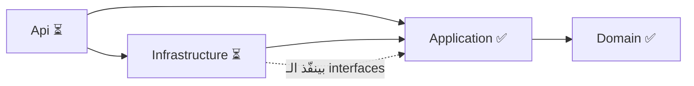
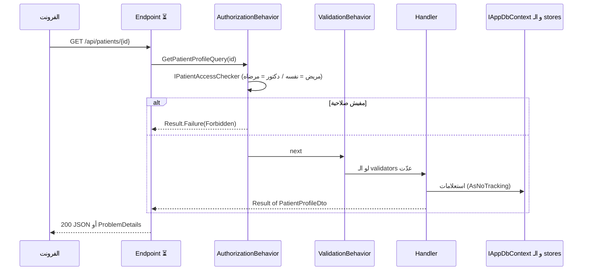
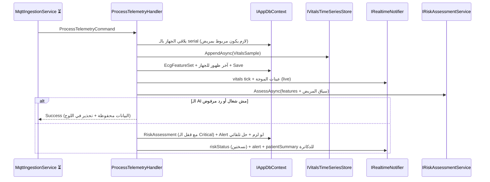

# تقرير تسليم الباك إند — CardioSense (النص الأول: Domain + Application)
**تاريخ:** 15 أكتوبر 2026
**الغرض من الملف ده:** إن أي حد يقراه يفهم الباك اللي اتبنى كأنه هو اللي كاتب الكود: كل فولدر بيعمل إيه، كل ملف جواه إيه وشغلته إيه، وإزاي الملفات بتكلم بعض وبتتوافق مع الفرونت اللي اتسلّم قبل كده.

---

## 1. ملخص سريع

- اتبنى **نص الباك بالظبط: طبقتين من أصل 4** — الـ **Domain** والـ **Application** (الطبقتين الداخليتين في الـ Clean Architecture).
- الأرقام: **Domain = 28 ملف C# (≈ 1,491 سطر)** و **Application = 100 ملف C# (≈ 4,086 سطر)** — يعني **128 ملف** و **≈ 5,577 سطر**، كلهم عليهم هيدر + كومنتات + XML docs على كل method.
- فيه **22 use case** (Commands / Queries) متوافقين حرفيًا مع الـ DTOs و الـ endpoints و الـ SignalR events اللي الفرونت مستنيها (اتفحص آليًا: 34 تطابق، تفاصيله في §8).
- اللي **لسه ⏳** (النص التاني): `Infrastructure` + `Api` + `tests` + `cardiosense-ai` (Python) + `docker-compose.yml`. فولدراتهم موجودة بنفس شكل الـ architecture (بـ `.gitkeep`) بس من غير كود.
- **مهم وصريح:** مفيش .NET SDK ولا إنترنت في الـ sandbox، فـ**ماعملتش `dotnet build` حقيقي**. بدله بنيت harness فحص ثابت واتجرّب بأخطاء مقصودة (§9). **أول حاجة تعملها: `dotnet build`** (طريقة التشغيل في §12).

## 2. ليه الـ Domain + Application هما "50%"؟

الباك 4 مشاريع، واتجاه الاعتماد من برّه لجوّه: `Api → Infrastructure → Application → Domain`.

- **Domain**: قواعد الشغل الصافية (مفيهاش أي مكتبة).
- **Application**: كل use case في فولدره + **العقود (interfaces)** اللي أي تكنولوجيا (SQL / Redis / MQTT / SignalR / HTTP) لازم تنفذها.
- **Infrastructure + Api** (النص التاني): التنفيذ الفعلي للعقود دي والـ endpoints. مفيهمش قرارات شغل — بس تنفيذ.

ده معناه إن النص اللي خلص هو **قلب النظام** والعقد الكامل مع الفرونت؛ والنص التاني بيوصّله بالعالم الخارجي من غير ما يغيّر حاجة فيه.



## 3. شجرة المشروع الكاملة

علامة ✅ = اتكتب وراجعته، ⏳ = فولدر فاضي بيستنى النص التاني.

```
back/
├── README.md                              # حالة المشروع وطريقة البناء
├── BACKEND_REPORT.md                      # التقرير ده
├── cardiosense-backend/                   # حل .NET
│   ├── CardioSense.sln                    # ✅ فيه Domain + Application (الباقي يتضاف مع النص التاني)
│   ├── Directory.Build.props              # ✅ إعدادات مشتركة (net10.0, nullable, implicit usings)
│   ├── Directory.Packages.props           # ✅ إصدارات الـ NuGet في مكان واحد
│   ├── .editorconfig / .gitignore         # ✅ أسلوب الكود + تجاهل ملفات البناء
│   ├── docker-compose.yml                 # ⏳ النص التاني
│   ├── src/
│   │   ├── CardioSense.Domain/
│   │   │   ├── Common/
│   │   │   │   ├── DomainErrors.cs                # ✅ فهرس أخطاء قواعد الدومين (Alert, Device, Vitals, Ecg, Risk, Electrode)
│   │   │   │   ├── Entity.cs                      # ✅ الأب لكل الكيانات: Id (GUID v7) + CreatedAt + حراس الإدخال
│   │   │   │   ├── Error.cs                       # ✅ وصف الخطأ: كود + رسالة + نوع (+ رسائل الحقول للـ validation)
│   │   │   │   ├── ErrorType.cs                   # ✅ أنواع الأخطاء (بتتحول لحالات HTTP في الـ Api)
│   │   │   │   └── Result.cs                      # ✅ نمط Result / Result<T>: نجاح أو خطأ بدل الـ exceptions
│   │   │   ├── Entities/
│   │   │   │   ├── Alert.cs                       # ✅ التنبيه + قاعدة: الـ Critical مبيتحلش إلا بدكتور
│   │   │   │   ├── AuditLogEntry.cs               # ✅ سجل التدقيق: مين فتح/عدّل أي ملف ومتى ومن أنهي IP
│   │   │   │   ├── Device.cs                      # ✅ الجهاز (serial) + ربط بمريض واحد + بطارية/إشارة/آخر ظهور
│   │   │   │   ├── Doctor.cs                      # ✅ بروفايل الدكتور (تخصص، رخصة، مستشفى...)
│   │   │   │   ├── DoctorPatientAssignment.cs     # ✅ ربط دكتور↔مريض (أساس الصلاحيات كلها)
│   │   │   │   ├── EcgFeatureSet.cs               # ✅ خصائص ECG المستخرجة (PR / QRS / QT / QTc)
│   │   │   │   ├── ElectrodeVerification.cs       # ✅ نتيجة فحص وضع الأقطاب بالكاميرا
│   │   │   │   ├── MedicalHistoryEntry.cs         # ✅ صف في السجل الطبي (تشخيص / دواء / حالة)
│   │   │   │   ├── Patient.cs                     # ✅ بروفايل المريض (السن بتتحسب من تاريخ الميلاد)
│   │   │   │   ├── RefreshToken.cs                # ✅ سجل الـ refresh token (hash فقط) + كشف إعادة الاستخدام
│   │   │   │   ├── RiskAssessment.cs              # ✅ تقييم الـ AI + قاعدة: ممنوع نزول Critical أوتوماتيك
│   │   │   │   └── VitalsSample.cs                # ✅ قراءة نبض/أكسجين (بحدود معقولة للحساس)
│   │   │   ├── Enums/
│   │   │   │   ├── AlertSeverity.cs               # ✅ Info / Transient / Moderate / Critical
│   │   │   │   ├── AlertType.cs                   # ✅ RiskThreshold / ManualEvent
│   │   │   │   ├── ConnectionMode.cs              # ✅ WiFi / Bluetooth
│   │   │   │   ├── ElectrodePlacementStatus.cs    # ✅ Optimal / RepositionNeeded
│   │   │   │   ├── Gender.cs                      # ✅ Male / Female
│   │   │   │   ├── MedicalHistoryEntryType.cs     # ✅ Diagnosis / Medication / Condition
│   │   │   │   ├── RiskStatusLevel.cs             # ✅ Stable / Caution / Critical (مرتبة بالخطورة)
│   │   │   │   └── UserRole.cs                    # ✅ Patient / Doctor
│   │   │   ├── Exceptions/
│   │   │   │   └── DomainException.cs             # ✅ استثناء لكسر قاعدة بسبب خطأ برمجي (مش للأخطاء المتوقعة)
│   │   │   ├── Interfaces/
│   │   │   │   ├── HeartRateRange.cs              # ✅ أقل وأعلى نبض في فترة (value type صغير)
│   │   │   │   └── IVitalsTimeSeriesStore.cs      # ✅ عقد تخزين السلاسل الزمنية (نقطة الانتقال لـ Phase 2)
│   │   │   └── CardioSense.Domain.csproj          # ✅ مشروع الـ Domain — من غير أي references أو packages
│   │   ├── CardioSense.Application/
│   │   │   ├── Auth/
│   │   │   │   ├── Commands/
│   │   │   │   │   ├── Login/
│   │   │   │   │   │   ├── LoginCommand.cs        # ✅ طلب تسجيل الدخول
│   │   │   │   │   │   ├── LoginHandler.cs        # ✅ فحص البيانات ثم إصدار جلسة
│   │   │   │   │   │   └── LoginValidator.cs      # ✅ تحقق شكل الإيميل والباسورد
│   │   │   │   │   ├── Logout/
│   │   │   │   │   │   ├── LogoutCommand.cs       # ✅ طلب تسجيل الخروج
│   │   │   │   │   │   └── LogoutHandler.cs       # ✅ إلغاء الـ refresh token (idempotent)
│   │   │   │   │   ├── RefreshToken/
│   │   │   │   │   │   ├── RefreshTokenCommand.cs # ✅ طلب تجديد الجلسة
│   │   │   │   │   │   └── RefreshTokenHandler.cs # ✅ تدوير التوكن + كشف السرقة (مع مهلة 10 ثواني)
│   │   │   │   │   ├── RegisterDoctor/
│   │   │   │   │   │   ├── RegisterDoctorCommand.cs # ✅ فورم تسجيل الدكتور
│   │   │   │   │   │   ├── RegisterDoctorHandler.cs # ✅ حساب + ملف دكتور في transaction واحد
│   │   │   │   │   │   └── RegisterDoctorValidator.cs # ✅ نفس قواعد Zod بتاعة الفرونت
│   │   │   │   │   └── RegisterPatient/
│   │   │   │   │       ├── RegisterPatientCommand.cs # ✅ فورم تسجيل المريض
│   │   │   │   │       ├── RegisterPatientHandler.cs # ✅ حساب + ملف + تاريخ مرضي في transaction واحد
│   │   │   │   │       └── RegisterPatientValidator.cs # ✅ نفس قواعد Zod بتاعة الفرونت
│   │   │   │   └── Common/
│   │   │   │       ├── AuthDtos.cs                # ✅ AuthenticatedUser / AuthResponse / RefreshResponse
│   │   │   │       ├── AuthSession.cs             # ✅ الجلسة الجديدة (الـ refresh token الخام للـ cookie بس)
│   │   │   │       └── SessionIssuer.cs           # ✅ بيطلّع الجلسة: access token + refresh token متخزن hash
│   │   │   ├── Common/
│   │   │   │   ├── Behaviors/
│   │   │   │   │   ├── AuthorizationBehavior.cs   # ✅ بيمنع أي طلب خاص بمريض لو المستخدم مالوش صلاحية
│   │   │   │   │   ├── ResultFailureFactory.cs    # ✅ بيصنع Result فاشل من أي نوع للـ behaviors
│   │   │   │   │   └── ValidationBehavior.cs      # ✅ بيشغّل الـ validators قبل الـ handler ويرجّع أخطاء الحقول
│   │   │   │   ├── Contracts/
│   │   │   │   │   └── ContractLiterals.cs        # ✅ القيم النصية المتفق عليها مع الفرونت (ar/en, 24h, daily, alert...)
│   │   │   │   ├── Dtos/
│   │   │   │   │   ├── AiReportDto.cs             # ✅ شكل تقرير الـ AI
│   │   │   │   │   ├── AlertDto.cs                # ✅ شكل التنبيه (وهو نفسه payload الـ push)
│   │   │   │   │   ├── ClinicalDtos.cs            # ✅ Vitals / EcgFeatures / RiskAssessment / Electrode DTOs
│   │   │   │   │   ├── DeviceSummaryDto.cs        # ✅ كارت الجهاز (serial, بطارية, آخر ظهور...)
│   │   │   │   │   ├── DoctorProfileDto.cs        # ✅ بروفايل الدكتور
│   │   │   │   │   ├── PagedResult.cs             # ✅ صفحة نتائج عامة (PaginatedResponse)
│   │   │   │   │   ├── PatientListItemDto.cs      # ✅ صف في قائمة مرضى الدكتور
│   │   │   │   │   ├── PatientProfileDto.cs       # ✅ الـ aggregate الكامل لملف المريض
│   │   │   │   │   ├── RealtimePayloads.cs        # ✅ payloads الـ SignalR (vitals / riskStatus / summary)
│   │   │   │   │   └── WardStatsDto.cs            # ✅ أرقام كروت الجناح للدكتور
│   │   │   │   ├── Errors/
│   │   │   │   │   └── ApplicationErrors.cs       # ✅ فهرس أخطاء الـ use cases (NotFound, AccessDenied...)
│   │   │   │   ├── Interfaces/
│   │   │   │   │   ├── IAppDbContext.cs           # ✅ واجهة قاعدة البيانات (DbSet لكل كيان + Save + Transaction)
│   │   │   │   │   ├── ICurrentUser.cs            # ✅ مين المستخدم الحالي (UserId, Role, PatientId, DoctorId)
│   │   │   │   │   ├── IIdentityService.cs        # ✅ إنشاء حساب / فحص الباسورد / اللغة (فوق ASP.NET Identity)
│   │   │   │   │   ├── IPatientAccessChecker.cs   # ✅ المكان الوحيد اللي بيقرر: هل المستخدم يشوف المريض ده؟
│   │   │   │   │   ├── IPatientScopedRequest.cs   # ✅ علامة على الطلبات الخاصة بمريض معيّن
│   │   │   │   │   ├── IRealtimeNotifier.cs       # ✅ قناة الـ push للمتصفحات (SignalR)
│   │   │   │   │   ├── IRiskAssessmentService.cs  # ✅ بوابة خدمة الـ AI (تقييم + نص التقرير)
│   │   │   │   │   └── ITokenService.cs           # ✅ إنشاء JWT و refresh token وعمل hash له
│   │   │   │   ├── Mappings/
│   │   │   │   │   ├── AlertMappings.cs           # ✅ Alert → AlertDto + نص نوع التنبيه
│   │   │   │   │   ├── ClinicalMappings.cs        # ✅ Vitals/ECG/Risk/Electrode → DTOs (مع إخفاء أرقام المريض)
│   │   │   │   │   ├── DeviceMappings.cs          # ✅ Device → DeviceSummaryDto
│   │   │   │   │   ├── ProfileMappings.cs         # ✅ تاريخ مرضي / دكتور / رقم الملف → DTOs
│   │   │   │   │   └── StatusLabels.cs            # ✅ نص حالة المريض (Fully Stable / Awaiting Data...)
│   │   │   │   ├── Models/
│   │   │   │   │   ├── AiModels.cs                # ✅ طلب/رد خدمة الـ AI
│   │   │   │   │   ├── IdentityModels.cs          # ✅ NewUser / UserAccount
│   │   │   │   │   └── TokenModels.cs             # ✅ AccessTokenRequest / AccessToken / GeneratedRefreshToken
│   │   │   │   ├── Options/
│   │   │   │   │   └── MonitoringOptions.cs       # ✅ إعدادات قابلة للتعديل (سعة الدكتور، نافذة الـ live)
│   │   │   │   ├── Security/
│   │   │   │   │   └── PatientAccessChecker.cs    # ✅ تنفيذ قاعدة الصلاحية (مريض=نفسه، دكتور=مرضاه)
│   │   │   │   └── Validation/
│   │   │   │       └── CommonRules.cs             # ✅ قواعد مشتركة: إيميل / باسورد / رقم قومي (14 رقم)
│   │   │   ├── Doctors/
│   │   │   │   ├── Commands/
│   │   │   │   │   └── UpdateDoctorProfile/
│   │   │   │   │       ├── UpdateDoctorProfileCommand.cs # ✅ تعديل جزئي لملف الدكتور
│   │   │   │   │       ├── UpdateDoctorProfileHandler.cs # ✅ بيحفظ الحقول ثم اللغة ويرجّع الملف
│   │   │   │   │       └── UpdateDoctorProfileValidator.cs # ✅ تحقق الحقول الموجودة بس
│   │   │   │   ├── Common/
│   │   │   │   │   ├── DoctorCaseload.cs          # ✅ استعلامات مشتركة لمرضى الدكتور (آخر تقييم/فحص لكل مريض)
│   │   │   │   │   └── PatientListItemAssembler.cs # ✅ بيبني صفوف قائمة المرضى بدفعة استعلامات واحدة
│   │   │   │   └── Queries/
│   │   │   │       ├── GetDoctorProfile/
│   │   │   │       │   ├── GetDoctorProfileHandler.cs # ✅ قراءة الملف + إيميل/لغة الحساب
│   │   │   │       │   └── GetDoctorProfileQuery.cs # ✅ ملف الدكتور الحالي
│   │   │   │       ├── GetMyPatients/
│   │   │   │       │   ├── GetMyPatientsHandler.cs # ✅ الأخطر أولًا ثم بالاسم
│   │   │   │       │   ├── GetMyPatientsQuery.cs  # ✅ قائمة المرضى (فلتر + بحث + صفحات)
│   │   │   │       │   └── GetMyPatientsValidator.cs # ✅ الفلتر والصفحة وحجمها
│   │   │   │       └── GetWardStats/
│   │   │   │           ├── GetWardStatsHandler.cs # ✅ كل الأرقام من مرضى الدكتور ده بس
│   │   │   │           └── GetWardStatsQuery.cs   # ✅ كروت إحصائيات الجناح
│   │   │   ├── Patients/
│   │   │   │   ├── Commands/
│   │   │   │   │   ├── AssignDoctor/
│   │   │   │   │   │   ├── AssignDoctorCommand.cs # ✅ زرار Add New Patient (بالرقم القومي)
│   │   │   │   │   │   ├── AssignDoctorHandler.cs # ✅ بيربط المريض بالدكتور ويرجّع صفه
│   │   │   │   │   │   └── AssignDoctorValidator.cs # ✅ تحقق المُعرّف
│   │   │   │   │   ├── FreezeWaveform/
│   │   │   │   │   │   ├── FreezeWaveformCommand.cs # ✅ تجميد/فك تجميد الموجة (دكتور)
│   │   │   │   │   │   └── FreezeWaveformHandler.cs # ✅ دكتور فقط + سطر log للسجل الإكلينيكي
│   │   │   │   │   ├── LogManualEvent/
│   │   │   │   │   │   ├── LogManualEventCommand.cs # ✅ تسجيل حدث يدوي (دكتور)
│   │   │   │   │   │   ├── LogManualEventHandler.cs # ✅ بيعمل Alert ويبعته live
│   │   │   │   │   │   └── LogManualEventValidator.cs # ✅ تحقق الملاحظة والخطورة
│   │   │   │   │   ├── PairDevice/
│   │   │   │   │   │   ├── PairDeviceCommand.cs   # ✅ ربط جهاز بمريض
│   │   │   │   │   │   ├── PairDeviceHandler.cs   # ✅ جهاز من المخزون فقط + جهاز واحد للمريض
│   │   │   │   │   │   └── PairDeviceValidator.cs # ✅ تحقق الـ serial
│   │   │   │   │   ├── ResolveAlert/
│   │   │   │   │   │   ├── ResolveAlertCommand.cs # ✅ حل تنبيه (دكتور)
│   │   │   │   │   │   ├── ResolveAlertHandler.cs # ✅ بيفك قفل الـ Critical بعد قرار الدكتور
│   │   │   │   │   │   └── ResolveAlertValidator.cs # ✅ تحقق الملاحظة
│   │   │   │   │   └── UpdatePatientProfile/
│   │   │   │   │       ├── UpdatePatientProfileCommand.cs # ✅ تعديل جزئي لملف المريض
│   │   │   │   │       ├── UpdatePatientProfileHandler.cs # ✅ المريض نفسه فقط + يرجّع الملف المحدّث
│   │   │   │   │       └── UpdatePatientProfileValidator.cs # ✅ تحقق الحقول الموجودة بس
│   │   │   │   ├── Common/
│   │   │   │   │   └── PatientProfileAssembler.cs # ✅ بيجمّع الـ aggregate الكامل (مشترك بين Get و Update)
│   │   │   │   └── Queries/
│   │   │   │       ├── GetDeviceStatus/
│   │   │   │       │   ├── GetDeviceStatusHandler.cs # ✅ بيرجّع NotFound حتى لو مفيش صلاحية (منع التخمين)
│   │   │   │       │   ├── GetDeviceStatusQuery.cs # ✅ حالة جهاز بالـ serial
│   │   │   │       │   └── GetDeviceStatusValidator.cs # ✅ تحقق الـ serial
│   │   │   │       ├── GetPatientAiReport/
│   │   │   │       │   ├── GetPatientAiReportHandler.cs # ✅ أرقام الفترة + نص من خدمة الـ AI (مبيتألفش)
│   │   │   │       │   ├── GetPatientAiReportQuery.cs # ✅ تقرير الـ AI لفترة
│   │   │   │       │   └── GetPatientAiReportValidator.cs # ✅ daily / weekly / monthly
│   │   │   │       ├── GetPatientAlerts/
│   │   │   │       │   ├── GetPatientAlertsHandler.cs # ✅ الأحدث أولًا وبحد أقصى 100
│   │   │   │       │   └── GetPatientAlertsQuery.cs # ✅ تنبيهات المريض
│   │   │   │       ├── GetPatientProfile/
│   │   │   │       │   ├── GetPatientProfileHandler.cs # ✅ بيخفي أرقام الـ AI عن المريض
│   │   │   │       │   └── GetPatientProfileQuery.cs # ✅ ملف المريض الكامل
│   │   │   │       └── GetPatientVitalsHistory/
│   │   │   │           ├── GetPatientVitalsHistoryHandler.cs # ✅ نقطة حقيقية لكل bucket (24h/7d/30d)
│   │   │   │           ├── GetPatientVitalsHistoryQuery.cs # ✅ تاريخ العلامات الحيوية
│   │   │   │           └── GetPatientVitalsHistoryValidator.cs # ✅ 24h / 7d / 30d
│   │   │   ├── Telemetry/
│   │   │   │   └── Commands/
│   │   │   │       ├── ProcessDeviceStatus/
│   │   │   │       │   ├── ProcessDeviceStatusCommand.cs # ✅ رسالة حالة الجهاز (بطارية/إشارة/firmware)
│   │   │   │       │   ├── ProcessDeviceStatusHandler.cs # ✅ تحديث صف الجهاز
│   │   │   │       │   └── ProcessDeviceStatusValidator.cs # ✅ حدود البطارية والإشارة
│   │   │   │       └── ProcessTelemetry/
│   │   │   │           ├── ProcessTelemetryCommand.cs # ✅ رسالة قراءة من الجهاز
│   │   │   │           ├── ProcessTelemetryHandler.cs # ✅ قلب النظام: حفظ → push → AI → تنبيهات → push
│   │   │   │           └── ProcessTelemetryValidator.cs # ✅ حدود القيم + منع التاريخ المستقبلي
│   │   │   ├── CardioSense.Application.csproj     # ✅ مشروع الـ Application: Mediator + FluentValidation + EF abstractions
│   │   │   └── DependencyInjection.cs             # ✅ AddApplication(): تسجيل كل حاجة بسطر واحد
│   │   ├── CardioSense.Infrastructure/                         # ⏳ النص التاني
│   │   │   ├── Persistence/Configurations/
│   │   │   ├── Persistence/Migrations/
│   │   │   ├── TimeSeries/
│   │   │   ├── Realtime/
│   │   │   ├── AiClient/
│   │   │   ├── Ingestion/
│   │   │   ├── Identity/
│   │   ├── CardioSense.Api/                         # ⏳ النص التاني
│   │   │   ├── Endpoints/
│   │   │   ├── Hubs/
│   │   │   ├── Authorization/
│   │   │   ├── Middleware/
│   └── tests/                             # ⏳ النص التاني
│       ├── CardioSense.Application.Tests/
│       └── CardioSense.Api.IntegrationTests/
└── cardiosense-ai/                        # ⏳ خدمة Python (FastAPI) — النص التاني
    ├── app/models/
    └── training/{notebooks,datasets}/
```


## 4. شرح الـ Domain (فولدر فولدر)

الـ Domain هو الدايرة الجوانية: **مفيهوش أي reference لمشروع أو package**، يعني مش شايف EF ولا HTTP ولا MQTT حتى بالغلط. كل اللي فيه "قواعد كانت هتفضل صح حتى لو غيرنا الـ framework بكره".

### 4.1 `Common/` — اللبنات الأساسية

| الملف | بيعمل إيه وليه |
|---|---|
| `Entity.cs` | الأب لكل الكيانات: `Id` (GUID من النوع v7 بيتولّد من الكيان نفسه من غير ما نسأل الداتا بيز) + `CreatedAt`. فيه 4 "حراس" بتتستخدم في كل factory: `RequireId` / `RequireText` / `RequireOptionalText` / `RequireRange` (بترمي `DomainException` لو حد مرّر قيمة مستحيلة — خطأ برمجي مش خطأ مستخدم). الـ setters كلها `private` فالحالة بتتغيّر بس عن طريق methods. |
| `ErrorType.cs` | تصنيف الفشل: Failure / Validation / Unauthorized / Forbidden / NotFound / Conflict / Unavailable. الـ Api هيحوّله لـ HTTP status (422/400/401/403/404/409/503). |
| `Error.cs` | وصف الخطأ: `Code` ثابت + `Description` + `Type` (+ `ValidationErrors` لرسائل كل حقل). فيه factory لكل نوع (`Error.NotFound(...)`...). |
| `Result.cs` | نمط **Result**: أي use case أو قاعدة بترجّع نجاح أو `Error` بدل ما ترمي exception للحالات المتوقعة. `Result<T>.Value` مينفعش تتقرا لو فشل (بترمي) فمفيش طريقة تاخد قيمة من نتيجة فاشلة بالغلط. الـ constructor بيمنع نتيجة "ناجحة وفيها خطأ" أو العكس. |
| `DomainErrors.cs` | فهرس الأخطاء اللي الكيانات بترجّعها (كود ثابت + رسالة): `Alert.CriticalRequiresDoctor`, `Device.AlreadyPaired`, `Vitals.HeartRateOutOfRange`... |

### 4.2 `Enums/` — القيم المسموحة

كل enum بقيم رقمية صريحة (عشان لو ترتيب الأعضاء اتغيّر الداتا المخزنة متتلخبطش). **الأسماء مطابقة حرفيًا لقيم الـ TypeScript** عند الفرونت (`RiskStatusLevel`, `AlertSeverity`, `ConnectionMode`, `UserRole`, `MedicalHistoryEntryType`)، ومتفحصة آليًا.

| Enum | القيم | ملاحظة |
|---|---|---|
| `RiskStatusLevel` | Stable < Caution < Critical | **مرتبة بالخطورة** فـ `Max()` على مجموعة بتطلّع أسوأ حالة (بتتستخدم في الـ timeline). |
| `AlertSeverity` | Info < Transient < Moderate < Critical | القيم اللي الفرونت افترضتها (كانت الفجوة رقم 1) — اتأكدت. |
| `AlertType` | RiskThreshold, ManualEvent | بيتحوّل لنص مقروء ("Risk Threshold") في الـ mapping لأن الفرونت بتعرض `type` زي ما هو. |
| `ElectrodePlacementStatus` | Optimal, RepositionNeeded | بيتحوّل لـ "Optimal Placement" / "Reposition Needed". |
| `UserRole`, `ConnectionMode`, `Gender`, `MedicalHistoryEntryType` | — | `Gender` بيتحوّل لـ `male`/`female` عن طريق `ContractLiterals`. |

### 4.3 `Entities/` — الكيانات (12 كيان) والقواعد اللي جواها

| الكيان | الحقول الأساسية | القاعدة / المنطق اللي جواه |
|---|---|---|
| `Patient` | UserId, FileNumber, FullName, DateOfBirth, Gender, NationalId, Phone | `GetAge(today)` بتحسب السن من تاريخ الميلاد؛ `DateOfBirthFromAge` بتقرّب التاريخ من السن (لأن الفورم بتجمع **سن** مش تاريخ ميلاد). `FileNumber` بتتولّد من الداتا بيز (sequence) وبتظهر `CS-0042`. `UpdateContact` بتعدّل الاسم/التليفون بس. |
| `Doctor` | UserId, FullName, Specialty, LicenseNumber, Hospital, Department?, Phone | رقم الرخصة مبيتعدّلش بعد الإنشاء؛ `UpdateProfile` بتعدّل الباقي. |
| `Device` | SerialNumber, PatientId?, PairedAt?, Firmware, Battery, LastSeenAt?, ConnectionMode, SignalStrengthDbm? | **`PairTo`**: الجهاز يتربط بمريض واحد بس (لو مربوط بمريض تاني ترجع `Device.AlreadyPaired`؛ ولنفس المريض تنجح تاني). `RecordStatus`/`RecordSeen` بتحدّث البطارية والإشارة وآخر ظهور (آخر ظهور بيتحرك لقدّام بس). `IsLive(now, window)` بتحدد هل الجهاز "لايف". |
| `DoctorPatientAssignment` | DoctorId, PatientId, AssignedAt, IsPrimary | **أساس الصلاحيات**: بتتفحص عند كل طلب دكتور على مريض. الدكتور الـ primary هو اللي زرار الاتصال بيرن عليه. |
| `MedicalHistoryEntry` | PatientId, EntryType, Description, RecordedAt | صفوف منفصلة (مش نص واحد) عشان الـ UI تعرضها/تعدلها لوحدها بعدين. |
| `VitalsSample` | PatientId, DeviceId, Timestamp, HeartRate, Spo2 | `Create` بترجّع Result: النبض لازم 20–300 والأكسجين 50–100، غير كده بتتعامل معاه كـ "artifact من الحساس" وبترفضه. |
| `EcgFeatureSet` | PR, QRS, QT, QTc (ms) + FeatureVectorJson | الفواصل لازم موجبة وتحت 2000ms (واسعة عن قصد عشان القيم المرضية الحقيقية تعدّي). مفيش موجة خام (مش بتتخزن). |
| `RiskAssessment` | StatusLevel, ConfidenceScore, ModelVersion, RiskScore?, Flags | **قاعدة الأمان الأهم**: لو فيه Critical alert مفتوح والـ AI قال "أحسن"، الحالة المخزّنة **بتفضل Critical** وبتتضاف علامة `critical_latched`. مفيش نزول أوتوماتيك من Critical — بس دكتور يحل الـ alert. |
| `Alert` | PatientId, Type, Severity, Message, TriggeredAt, ResolvedAt?, ResolutionNote? | **`Resolve`**: الـ Critical مبيتحلش إلا بدكتور (`Forbidden`) والـ alert مبيتحلش مرتين (`Conflict`). بياخد الوقت كـ parameter (مش `UtcNow`) فالكيان بيفضل قابل للاختبار. |
| `ElectrodeVerification` | PatientId, Timestamp, PlacementStatus, ConfidenceScore (0..1) | `Create` بترفض ثقة برّه 0..1. |
| `AuditLogEntry` | UserId?, Action, EntityType, EntityId?, Timestamp, IpAddress? | سجل "مين شاف ملف المريض ده" (متطلب حقيقي للبيانات الطبية). بيتكتب من الـ middleware (النص التاني). |
| `RefreshToken` | UserId, TokenHash, ExpiresAt, RevokedAt? | بيتخزن **hash بس**. `IsUsable` و `IsReplay` بياخدوا الوقت و"مهلة 10 ثواني" عشان نفرّق بين طلبين تجديد متزامنين بريئين (تابين / React StrictMode) وبين سرقة توكن. |

### 4.4 `Exceptions/` و `Interfaces/`

- `DomainException.cs`: استثناء للأخطاء **البرمجية** بس (id فاضي مثلًا). الأخطاء المتوقعة كلها Result.
- `IVitalsTimeSeriesStore.cs`: **نقطة الانتقال Phase 1 → Phase 2**: الـ handlers تعتمد على الواجهة دي بس لقراءة/كتابة العلامات الحيوية (مش على الـ DbContext). فيها 6 methods: `AppendAsync`, `GetLatestAsync`, `GetLatestForPatientsAsync`, `GetHistoryAsync` (نقطة حقيقية واحدة لكل bucket عشان الـ chart متستلمش آلاف النقاط), `GetHeartRateRangesAsync`, `GetAverageHeartRateAsync`. النهارده SQL Server، بكره InfluxDB بتغيير سطر DI واحد.
- `HeartRateRange.cs`: struct صغير (Min, Max) للواجهة اللي فوق.


## 5. شرح الـ Application

### 5.1 الفكرة العامة

- **كل use case في فولدر لوحده**: `XCommand` / `XQuery` (الطلب = `record`) + `XHandler` (التنفيذ، `internal sealed`) + `XValidator` (FluentValidation) لو فيه مدخلات تحتاج تحقق.
- الـ Handler **مبيتكلمش مع HTTP ولا قاعدة بيانات محددة**: بيكلّم **interfaces** (`IAppDbContext`, `IVitalsTimeSeriesStore`, `IRealtimeNotifier`, ...) والنص التاني بيوفر التنفيذ.
- كل طلب بيعدّي على **pipeline** قبل الـ handler (بالترتيب): ① `AuthorizationBehavior` ② `ValidationBehavior` ③ الـ Handler.
- كل handler بيرجّع `Result` / `Result<T>` — مفيش exceptions للحالات المتوقعة.
- Mediator هنا هو المكتبة source-generated (MIT) المذكورة في الـ architecture doc، مش MediatR.

### 5.2 `Common/` — الحاجات المشتركة

| الفولدر | الملف | بيعمل إيه |
|---|---|---|
| `Behaviors/` | `AuthorizationBehavior.cs` | لو الطلب بيطبّق `IPatientScopedRequest` (يعني خاص بمريض معيّن) ويوزر مالوش صلاحية → بيرجّع `Forbidden` **قبل** أي حاجة تانية. ده المكان الوحيد اللي بيطبّق قاعدة "الدكتور يشوف مرضاه بس" لكل الـ endpoints (مفيش endpoint يقدر ينساها). |
| | `ValidationBehavior.cs` | بيشغّل كل الـ validators؛ لو فيه أخطاء بيرجّع `Result` فاشل نوعه Validation فيه رسائل كل حقل **بأسماء camelCase** (`nationalId`) عشان الفرونت تربطها بالحقل. |
| | `ResultFailureFactory.cs` | helper داخلي: بيصنع `Result` أو `Result<T>` فاشل من أي نوع (الـ behaviors عامة ومعرفش الـ T). بيتبني مرة لكل نوع ويتخزّن. |
| `Interfaces/` | `IAppDbContext` | `DbSet` لكل كيان + `SaveChangesAsync` + `BeginTransactionAsync`. الـ handlers بتكتب LINQ مباشرة (من غير repository لكل كيان). **العلامات الحيوية مش فيه** عن قصد (بتروح من `IVitalsTimeSeriesStore`). |
| | `ICurrentUser` | `UserId`, `Role`, `PatientId`, `DoctorId` للمستخدم الحالي. |
| | `IPatientAccessChecker` + `IPatientScopedRequest` | قاعدة الصلاحية + علامة الطلبات الخاصة بمريض. |
| | `IIdentityService` | `CreateUserAsync` / `ValidateCredentialsAsync` / `FindByIdAsync` / `UpdatePreferredLanguageAsync` فوق ASP.NET Identity (الإيميل واللغة عايشين في جدول Users). |
| | `ITokenService` | `CreateAccessToken` / `GenerateRefreshToken` / `HashRefreshToken`. |
| | `IRiskAssessmentService` | `AssessAsync` (POST /analyze) و `GenerateReportNarrativeAsync` (POST /report — جديدة). |
| | `IRealtimeNotifier` | 5 methods = 5 events بتاعة الفرونت (`vitals`, `ecg`, `riskStatus`, `alert`, `patientSummary`). مكتوب جواها إن الإرسال best-effort ومينفعش يرمي exception. |
| `Dtos/` | 10 ملفات | **نسخ C# طبق الأصل من `shared/types/api.ts`** (أسماء الحقول بتتحوّل camelCase). تفاصيل التطابق في §8. |
| `Mappings/` | `AlertMappings`, `ClinicalMappings`, `DeviceMappings`, `ProfileMappings`, `StatusLabels` | دوال نقية: كيان → DTO. `ClinicalMappings.ToDto(risk, includeClinicalDetails)` بيشيل ثقة/سكور/flags من رد المريض. `StatusLabels` بيطلّع "Fully Stable / Clinical Alert / Critical Alert / **Awaiting Data**" (المريض بلا تقييم مبيظهرش "سليم" بالغلط). |
| `Models/` | `AiModels`, `IdentityModels`, `TokenModels` | records صغيرة بتعدّي الحدود بين الـ Application والـ Infrastructure (عشان مفيش نوع من ASP.NET Identity أو JWT يتسرّب هنا). |
| `Options/` | `MonitoringOptions` | قيمتين قابلين للتعديل: `DoctorPatientCapacity` (50 — "42/50") و `DeviceLiveWindowSeconds` (120). الافتراضي شغال حتى لو الـ host معملش config. |
| `Security/` | `PatientAccessChecker` | تنفيذ القاعدة: **المريض = نفسه** (من الـ claims من غير DB)، **الدكتور = مرضاه** (استعلام واحد على `DoctorPatientAssignments`)، أي حد تاني مرفوض. |
| `Validation/` | `CommonRules` | قواعد مشتركة مطابقة لـ Zod: إيميل (≤255)، باسورد (8–128)، رقم قومي = **14 رقم ASCII** (`[0-9]{14}`؛ مش `\d` عشان .NET بيقبل الأرقام العربية و JavaScript لأ). |
| `Errors/` | `ApplicationErrors` | فهرس الأخطاء: `Auth.InvalidCredentials`, `Patient.NotFound`, `Patient.AccessDenied`, `Doctor.DoctorOnly`, `Device.NotFound`, `Report.NoData`... |
| `Contracts/` | `ContractLiterals` | القيم النصية اللي الفرونت بتبعتها ومينفعش تبقى enum: `ar/en`, `male/female`, `24h/7d/30d`, `daily/weekly/monthly`, `all/stable/alert/critical` + parsing بتاعها. **تعريف واحد بيستخدمه الـ validator والـ handler.** |
| (root) | `DependencyInjection.cs` | `services.AddApplication()`: بيسجّل Mediator (بترتيب الـ behaviors) + كل الـ validators + الخدمات الداخلية + `TimeProvider.System`. |

### 5.3 الـ use cases (22) — مين بيستدعيها وأهم قواعدها

> عمود "الـ endpoint" = الـ endpoint اللي هيتبني في الـ Api (النص التاني). **الصلاحية** بين قوسين: من اللي بيفرضها.

#### Auth (5)

| الـ use case | الـ endpoint | المنطق |
|---|---|---|
| `Login` | `POST /api/auth/login` | `IIdentityService.ValidateCredentialsAsync` ← `SessionIssuer`. الإيميل غلط والباسورد غلط بيرجّعوا نفس الخطأ (مبيكشفش مين مسجّل). |
| `RegisterPatient` | `POST /api/auth/signup/patient` | رقم قومي مكرر → `Conflict`. **transaction واحدة**: حساب + ملف مريض + سجل تشخيص + سجل أدوية. اختياري وبمحاولة فقط (لو فشل التسجيل ينجح): ربط الدكتور بالاسم **لو دكتور واحد بس بنفس الاسم**، وربط الجهاز **لو في المخزون وحر**. السن بيتحوّل لتاريخ ميلاد تقريبي. ثم جلسة جاهزة (المستخدم يدخل الداشبورد على طول). |
| `RegisterDoctor` | `POST /api/auth/signup/doctor` | رخصة مكررة → `Conflict`. حساب + ملف دكتور في transaction ثم جلسة. |
| `RefreshToken` | `POST /api/auth/refresh` | يلاقي التوكن بالـ hash ← **تدوير** (القديم يتلغي لحظة إصدار الجديد). توكن ملغي بيتقدّم تاني بعد **10 ثواني** = سرقة → **كل جلسات اليوزر بتتلغي**. جوه الـ 10 ثواني بنقبله (تابين أو React StrictMode بيبعتوا نفس الكوكي مرتين). |
| `Logout` | `POST /api/auth/logout` (ناقص في الـ doc، الفرونت بتنده عليه) | بيلغي الـ refresh token؛ بدون توكن أو توكن مجهول = نجاح (idempotent). |

`SessionIssuer` (في `Auth/Common`) هو اللي بيخلّص كل مسار تسجيل دخول: يلاقي بروفايل المريض/الدكتور، يعمل access token (claims فيها `patientId`/`doctorId`)، يعمل refresh token ويخزّنه **hash**، ويرجّع `AuthSession`. الـ Api بعدها بيقسمها: `RawRefreshToken` → كوكي httpOnly، والباقي (`ToResponse()`) → JSON.

#### Patients — الاستعلامات (5)

| الـ use case | الـ endpoint | الصلاحية | المنطق |
|---|---|---|---|
| `GetPatientProfile` | `GET /api/patients/me` و `/api/patients/{id}` | pipeline | بيجمّع الـ aggregate كله من `PatientProfileAssembler`: ملف + دكتور primary + جهاز + تاريخ مرضي + آخر vitals/ECG/تقييم/أقطاب + **timeline آخر 24 ساعة** (أسوأ حالة في كل ساعة، بتوقيت السيرفر `TZ`). **المريض** بيستلم الحالة فقط؛ **الدكتور** بيستلم الثقة والسكور والـ flags. |
| `GetPatientVitalsHistory` | `.../vitals-history?range=` | pipeline | `24h`→bucket 5 دقايق، `7d`→ساعة، `30d`→6 ساعات: **نقطة حقيقية (الأحدث) لكل bucket** (مفيش أرقام متألفة) والتجميع بيتم في الداتا بيز. |
| `GetPatientAlerts` | `.../alerts` | pipeline | الأحدث أولًا وبحد أقصى 100. |
| `GetPatientAiReport` | `.../ai-report?period=` | pipeline | متوسط النبض + أعلى سكور + عدد التنبيهات للفترة، والنص من خدمة الـ AI. **مفيش بيانات = `NotFound`** (الفرونت تعرض "فاضي") و**الـ AI واقف = الخطأ يعدّي** — مبيتألفش تقرير أبدًا. |
| `GetDeviceStatus` | `GET /api/devices/{serial}/status` | الـ handler | جهاز مفيش صلاحية عليه بيرجّع `NotFound` زي المجهول (عشان محدش يخمّن الـ serials). |

#### Patients — الأوامر (6)

| الـ use case | الـ endpoint | الصلاحية | المنطق |
|---|---|---|---|
| `UpdatePatientProfile` | `PUT /api/patients/me` | الـ handler (المريض نفسه) | تعديل جزئي: الاسم/التليفون/اللغة. التاريخ الطبي للقراءة فقط (البيانات الطبية تتغير عن طريق دكتور). بيرجّع الملف المحدّث. |
| `PairDevice` | `POST /api/devices/pair` | الـ handler + `IPatientAccessChecker` | **جهاز من المخزون بس** (serial مجهول = `NotFound`). مريض واحد = جهاز واحد (التاني `Conflict`) لأن استبدال جهاز بصمت ممكن يوقف المراقبة. الدكتور لازم يبعت `patientId`. |
| `LogManualEvent` | `POST /api/patients/{id}/manual-events` | pipeline + دكتور | بيعمل `Alert` نوعه ManualEvent ويبعته live. لو Critical بيقفل حالة المريض لحد ما دكتور يحله. |
| `FreezeWaveform` | `POST /api/patients/{id}/freeze-waveform` | pipeline + دكتور | الموجة الخام مش بتتخزن فمفيش تغيير في الداتا؛ بس تأكيد + سطر log بـ(patientId, doctorId, الحالة) للسجل الإكلينيكي (الفرونت بتتجاهل الرد). |
| `ResolveAlert` | `POST /api/patients/{id}/alerts/{alertId}/resolve` (**جديد**) | pipeline + دكتور | بيحل التنبيه عن طريق `Alert.Resolve` — **ده اللي بيفك قفل الـ Critical**. بدونه القاعدة اللي في الـ Domain كانت هتبقى مش قابلة للوصول. |
| `AssignDoctor` | `POST /api/doctors/me/patients` | الـ handler (دكتور) | زرار "Add New Patient": بيلاقي المريض **بالرقم القومي** ويربطه بالدكتور (primary لو مفيش primary)، ولو متربط قبل كده يرجّع صفه عادي (idempotent). كود الدعوة (invite code) غير مدعوم لسه (§11). |

#### Doctors (4)

| الـ use case | الـ endpoint | المنطق |
|---|---|---|
| `GetDoctorProfile` | `GET /api/doctors/me` (**ناقص في الـ doc**) | الفرونت بتناديه بعد الـ refresh عشان تعرف اسم الدكتور وتخصصه. |
| `UpdateDoctorProfile` | `PUT /api/doctors/me` (**ناقص في الـ doc**) | تعديل جزئي (رقم الرخصة مبيتعدّلش). |
| `GetMyPatients` | `GET /api/doctors/me/patients?status=&search=&page=` | **مرضى الدكتور ده بس**. فلتر الحالة (alert = Caution)، بحث بالاسم أو رقم الملف، ترتيب **الأخطر أولًا** ثم بالاسم، صفحات (الافتراضي 5 = `PATIENT_LIST_PAGE_SIZE` عند الفرونت). الفلترة في الذاكرة بعد استعلامات batch لأن الـ caseload بعشرات. |
| `GetWardStats` | `GET /api/doctors/me/ward-stats` | `activePatients` = مرضاه، الأرقام بتجمع على بعض (stable + alert + critical = active)، الأجهزة "connected" = ظهرت خلال النافذة، `signalAccuracyPercent` = متوسط ثقة آخر فحص أقطاب لكل مريض ×100. |

#### Telemetry (2) — بيستدعيها الـ MQTT worker (النص التاني)

| الـ use case | الـ topic | المنطق |
|---|---|---|
| `ProcessTelemetry` | `devices/{serial}/telemetry` | **قلب النظام** — الشرح في §6.2. |
| `ProcessDeviceStatus` | `devices/{serial}/status` | بيحدّث البطارية/الإشارة/firmware/آخر ظهور للجهاز. serial مجهول = رفض (الـ broker مينفعش يخلق أجهزة). |


## 6. رحلة الطلبات — إزاي الملفات بتكلّم بعض

### 6.1 طلب REST عادي (مثال: دكتور بيفتح ملف مريض)



القاعدة: الـ Endpoint (النص التاني) ثلاث أربع سطور بس — بياخد الطلب، يبعته للـ mediator، ويحوّل الـ `Result` لـ HTTP. أي `if` له معنى شغل مكانه الـ handler أو الـ Domain.

### 6.2 رسالة جهاز واحدة (`ProcessTelemetry`)



**ليه الترتيب ده؟** اللي الجهاز قاسه بيتحفظ ويتعرض الأول؛ فلو الـ AI وقع نخسر "تقييم" بس مش بيانات.

**سياسة التنبيهات** (جوّه `ProcessTelemetryHandler`، بتمنع إن كل قراءة تعمل تنبيه):
1. الحالة الفعلية **Critical** ومفيش Critical مفتوح ← Alert جديد (Critical).
2. الحالة **Caution** بعد **Stable** (أو أول تقييم) ← Alert (Moderate).
3. الحالة رجعت **Stable** ← التنبيهات المفتوحة من نوع RiskThreshold وغير الـ Critical **بتتحل أوتوماتيك**؛ الـ Critical مبيتحلش إلا بدكتور (`ResolveAlert`).

**الـ push بنسختين:** `RiskStatusBroadcast` فيه `Clinical` (للدكاترة: ثقة + سكور + flags) و `PatientView` (للمريض: الحالة بس). الـ Application هو اللي بيقرر مين ياخد إيه (قاعدة المنتج: "المريض يشوف حالة مش رقم")، والـ notifier بيوزّع بس.

**الموجة الحية:** `EcgSamples` اختيارية في الأمر، بتتبعت للمتصفحات وبس — مفيش تخزين للموجة الخام (حسب الـ architecture doc).

## 7. القرارات والتصحيحات خارج الـ architecture doc

| # | البند | اللي في الـ doc | اللي اتعمل | السبب |
|---|---|---|---|---|
| 1 | نوع `Alert.Severity` | مثال الكود بيستخدم `RiskStatusLevel` بينما فولدر الـ Enums فيه `AlertSeverity` | استخدمت **`AlertSeverity`** (Info/Transient/Moderate/Critical) | تناقض داخل الـ doc؛ والفرونت افترضت نفس القيم. |
| 2 | شكل الخطأ | `Result.Failure("نص")` | `Result.Failure(Error)` بـ**كود + نوع** | عشان الـ Api يحوّل أي خطأ لـ ProblemDetails بالـ status الصح (§13 في الـ doc). |
| 3 | الوقت داخل الكيانات | `ResolvedAt = DateTimeOffset.UtcNow` | الوقت **parameter** (`now`) | الكيان يفضل deterministic وقابل للاختبار (وده نفس نمط الـ skill). |
| 4 | كيان `RefreshToken` | جدول بس في الـ doc | كيان في الـ Domain | `IAppDbContext` لازم يقدر يوصله من الـ handlers. |
| 5 | `IIdentityService` و `ITokenService` | مش موجودين في قائمة الـ interfaces | اتضافوا | الـ handlers مينفعش تتكلم مع `UserManager`/JWT مباشرة. |
| 6 | تطبيق الصلاحيات | `PatientAccessHandler` في الـ Api | القاعدة اتنقلت لـ `IPatientAccessChecker` + `AuthorizationBehavior` في الـ pipeline | تتفرض على **كل** مدخل (مش بس REST) ومفيش endpoint ينساها. `PatientAccessHandler` في الـ Api هيبقى adapter رفيع (مهم لـ SignalR hub). |
| 7 | use cases ناقصة في الـ doc | — | `Logout`, `GetDoctorProfile`, `UpdateDoctorProfile`, `GetPatientAiReport` (فجوات الفرونت) + `UpdatePatientProfile`, `GetDeviceStatus`, `ResolveAlert`, `ProcessDeviceStatus` | مطلوبين لتشغيل الفرونت وجدول الـ endpoints والـ domain rules. |
| 8 | سكور المخاطرة | مفيش عمود | `RiskAssessment.RiskScore` (0–100، اختياري) + الـ AI ممكن يرجّعه | الفرونت بتعرض "18/100" للدكتور (فجوة 2). |
| 9 | عمود `QtQtcMs` | عمود واحد | `QtMs` و `QtcMs` عمودين، والـ DTO بيرجّع `[QT, QTc]` | أنضف في الداتا بيز ومتوافق مع الفرونت. |
| 10 | `Device.SignalStrengthDbm` | الـ doc بيقول الـ status فيه "signal" بس مفيش عمود | عمود اختياري | الكارت بتعرضه. |
| 11 | رقم الملف `CS-0042` | غير موجود | `Patient.FileNumber` يتولّد من الداتا بيز (sequence) | الفرونت بتعرضه ومحتاج رقم فريد ثابت. |
| 12 | السن | `DateOfBirth` في الجدول، والفورم بتبعت `age` | بنحوّل السن لتاريخ ميلاد تقريبي | الفرونت لازم تجمع تاريخ الميلاد مستقبلًا (§11). |
| 13 | مهلة تجديد التوكن | "يتلغي القديم فورًا" | مهلة **10 ثواني** قبل ما نعتبره سرقة | `AuthProvider` بتعمل refresh مرتين في dev (React StrictMode) وممكن تابين — من غير مهلة المستخدم بيتطرد. |
| 14 | توقيت الـ timeline | غير محدد | بتوقيت السيرفر (`TimeProvider.LocalTimeZone`) | اظبط `TZ=Africa/Cairo` على الـ container. |
| 15 | إخفاء أرقام الـ AI عن المريض | "الـ UI هي المسؤولة" (تعليق الفرونت) | الباك **بيشيلها فعلًا** من رد المريض ومن الـ push | عشان متبقاش في الـ network tab. |
| 16 | `Application/DependencyInjection.cs` | غير مذكور | `AddApplication()` | الـ source generator في الـ Application فلازم نقطة تسجيل منها. |
| 17 | `Directory.Build.props` و `Directory.Packages.props` و `.editorconfig` | غير مذكورين | اتضافوا | إعدادات مشتركة ونسخ حزم في مكان واحد (معيار في الحلول متعددة المشاريع). |
| 18 | حدود القراءات | غير محدد | نبض 20–300، أكسجين 50–100، فواصل ECG 1–2000ms | القيم خارج كده = artifact بيترفض (واسعة عشان القيم المرضية الحقيقية تعدّي). |

## 8. التوافق مع الفرونت

### 8.1 تطابق الـ DTOs

الـ harness بيقرا `shared/types/api.ts` فعليًا وبيقارن **أسماء الحقول** بالـ records (بعد تحويل camelCase): **34 تطابق كامل** (كل الـ DTOs + الـ requests + الـ payloads + الـ enums). الاستثناءات المقصودة:

| حقل في TypeScript | ليه مش موجود في الباك |
|---|---|
| `PatientListItem.bedOrRoom` / `bloodPressure` / `stElevationMm` | اختيارية في الـ TS ومفيش مصدر بيانات ليها (مفيش حساس ضغط ولا سرير في التصميم). |
| `ElectrodeVerification.impedanceKOhm` | اختياري، ومفيش عمود ليه في الـ doc. |

> الـ Api (النص التاني) لازم يستخدم `JsonStringEnumConverter` (بدون naming policy) عشان `Stable` / `Critical` / `WiFi` تتبعت بنفس الكتابة، وكمان الـ camelCase الافتراضي. `Spo2` مقصود يتسمّى كده (مش `SpO2`) عشان يطلع `spo2`.

### 8.2 ردود على الفجوات العشر في `HANDOFF_REPORT.md` بتاع الفرونت

| # | الفجوة | الرد |
|---|---|---|
| 1 | قيم `AlertSeverity` | مؤكدة: `Info / Transient / Moderate / Critical`. |
| 2 | `riskScore` | موجود: `RiskAssessment.RiskScore` (0–100 اختياري)، والـ AI ممكن يرجّعه؛ للدكتور بس. |
| 3 | Log Manual Event | بيتسجل كـ `Alert` نوعه `ManualEvent` (زي ما الـ doc بيقول). |
| 4 | Freeze Waveform | مفيش تغيير داتا؛ تأكيد + log للسجل الإكلينيكي (والـ audit middleware هيسجّله). |
| 5 | `GET /api/doctors/me` | اتعمل: `GetDoctorProfile`. |
| 6 | `PUT /api/doctors/me` | اتعمل: `UpdateDoctorProfile`. |
| 7 | `POST /api/auth/logout` | اتعمل: `Logout` (يلغي الـ refresh token). |
| 8 | AI report | اتعمل: `GetPatientAiReport` + method جديدة في `IRiskAssessmentService` (النص لازم يجي من خدمة الـ AI — endpoint جديد `POST /report` عندها). |
| 9 | Review Strip (آخر 15 دقيقة) | **مش مدعومة** (الموجة الخام مش بتتخزن)؛ مفيش endpoint، ومودال الفرونت اللي بيشرح ده يفضل. |
| 10 | `heartRateRange` | الباك بيحسبه (أقل/أعلى نبض في 24 ساعة من الـ store). |


## 9. التحقق والاختبار — بصراحة

### 9.1 القيد
مفيش `dotnet` ولا إنترنت في الـ sandbox (اتأكدت: `dotnet: not found`)، فمقدرتش أعمل `dotnet build` ولا أشغّل اختبارات. ماعملتش حاجة وهمية: بنيت **harness فحص ثابت** (Python + Pygments بيقرا الـ C# فعليًا) واتجرّب قبل ما أثق في نتايجه، زي ما اتعمل في الفرونت.

### 9.2 اللي بيفحصه (`check_backend.py` + `ident_check.py`)

| الفحص | بيكشف إيه |
|---|---|
| توازن `{ } ( ) [ ]` | أقواس ناقصة/زايدة |
| الهيدر | كل ملف عنده File / Layer / Purpose / Logic / Implementation واسم الملف صحيح |
| الـ namespace | = مسار الفولدر بالظبط (file-scoped) |
| الـ `using` | ناقص / زايد / مش مترتب؛ وكمان أي اعتماد على طبقة برّه (Domain مفيهوش غير `System` و `CardioSense.Domain`) |
| التوثيق | كل method/constructor/type/property عنده `///` |
| الـ wiring | كل طلب له handler واحد بنفس نوع الرد؛ كل validator لطلب موجود |
| الكود الميت | private members / primary-constructor parameters / locals مش مستخدمة |
| تصادم الأسماء | اسم namespace بيغطي اسم type (حصل فعلًا مع `RefreshToken` — اتعالج) |
| توافق الـ contract | الـ DTOs مع `shared/types/api.ts` (حقول + enums) |
| أنواع الرجوع | `Result.Failure<X>` جوه method بترجّع `Result<Y>` |
| الـ async | method `async` من غير `await` |
| اسم متغير غلط | متغير lower-case مستخدم ومش متعرّف (typos) |
| النظافة | tabs، trailing spaces، TODO، سطر أطول من 120 |

### 9.3 النتيجة
**128 ملف · 22 طلب = 22 handler · 15 validator · 34 تطابق مع الفرونت · 0 مشاكل.** بالإضافة لـ: الـ csproj / props / sln XML سليمة والـ sln بيشاور على ملفات موجودة.

### 9.4 اختبار الـ harness نفسه
حقنت **11 عيب مقصود** في نسخة منفصلة (using ناقص، namespace غلط، قوس ناقص، توثيق ناقص، parameter مش مستخدم، handler بنوع رد غلط، حقل اتشال من DTO، اعتماد Domain على Application، `RefreshToken` bare داخل namespace الـ Auth، متغير ميت، `Result.Failure<AlertDto>` جوه method بترجّع `Result<DeviceSummaryDto>`) — **كلهم اتكشفوا**.

### 9.5 مشاكل حقيقية اتلقت وصلّحتها قبل التسليم
1. `using FluentValidation` زايد في `DependencyInjection.cs`.
2. أولوية العمليات: `a ?? b is not { } x` كانت بتتفسّر غلط (اتحطت أقواس) في `PairDeviceHandler`.
3. الرقم القومي: `\d` في .NET بيقبل أرقام عربية (والفرونت لأ) → بقت `[0-9]{14}`.
4. `RefreshToken`: من غير مهلة، فتح التطبيق في dev (StrictMode) كان هيطرد المستخدم كل مرة → مهلة 10 ثواني (§7 بند 13).
5. استعلامات "المريض موجود؟" زيادة عن الـ pipeline اتشالت من `LogManualEvent` و `FreezeWaveform` (والأخيرة بقت من غير DbContext أصلًا).
6. ترتيب الـ usings وتقسيم الأسطر الطويلة وإعادة تنسيق الهيدرات.

### 9.6 اللي لسه مش متأكد منه (محتاج `dotnet build` حقيقي)
- **أسماء API مكتبة Mediator (v3)**: `IPipelineBehavior<,>` و `MessageHandlerDelegate<,>` و `options.PipelineBehaviors` و `AddMediator` — كتبتها من توثيق المكتبة ومتحققتش منها بكومبايلر. لو البناء وقع هنا فده أول مكان تبص عليه.
- **إصدارات الـ NuGet** في `Directory.Packages.props` (Mediator 3.0.0, FluentValidation 12.0.0, EF Core 10.0.0...) حدّها الأدنى؛ لو restore اشتكى غيّر الرقم.
- **تحذيرات nullable** متوقعة من FluentValidation على الحقول `string?` (تحذيرات مش أخطاء؛ `TreatWarningsAsErrors` مقفول).
- **استعلامات EF** (joins و group-by) متجربتش على داتا بيز فعلية.
- **مفيش unit tests لسه** (فولدر `tests/` فاضي — ضمن النص التاني).

## 10. العقود المطلوبة من النص التاني (دي "المواصفات" اللي الـ Infrastructure والـ Api لازم يلتزموا بيها)

| العقد (Application/Domain) | التنفيذ المنتظر | المطلوب بالظبط |
|---|---|---|
| `IAppDbContext` | `Persistence/AppDbContext.cs` + `Configurations/*` + `Migrations/` | يورّث `IdentityDbContext<ApplicationUser, IdentityRole<Guid>, Guid>`؛ **DbSet لكل الكيانات + `VitalsSamples`** (الأخيرة مش في الـ interface، الـ store هو اللي بيستخدمها)؛ الـ enums كـ **string**؛ `RiskAssessment.Flags` كـ JSON في عمود **`ContributingFactorsJson`**؛ `Patient.FileNumber` من **sequence** (`HasSequence` + default `NEXT VALUE FOR`)؛ **unique indexes**: Patients.NationalId, Doctors.LicenseNumber, Devices.SerialNumber, RefreshTokens.TokenHash, (DoctorId, PatientId) في الـ assignments؛ **indexes أداء**: (PatientId, Timestamp) على VitalsSamples/RiskAssessments/EcgFeatureSets/ElectrodeVerifications، و(PatientId, TriggeredAt) و(PatientId, Severity, ResolvedAt) على Alerts؛ FK من Patients.UserId و Doctors.UserId للـ Users. |
| `IVitalsTimeSeriesStore` | `TimeSeries/SqlVitalsTimeSeriesStore.cs` | `GetHistoryAsync` = **أحدث صف لكل bucket** (GROUP BY على `DATEDIFF`/قسمة صحيحة) وبترتيب تصاعدي؛ `GetLatestForPatientsAsync` و `GetHeartRateRangesAsync` بدفعة واحدة لكل المرضى؛ Redis cache اختياري كـ decorator. |
| `IIdentityService` | `Identity/IdentityService.cs` + `ApplicationUser` (فيه `Role` و `PreferredLanguage`) | تحويل `IdentityError` → `Error`: إيميل مكرر = `Conflict`، باسورد ضعيف = `Validation`، قفل الحساب = `Forbidden`، بيانات غلط = `ApplicationErrors.Auth.InvalidCredentials`. إعدادات Identity: **RequiredLength = 8 وباقي شروط التعقيد false** (مطابقة للفرونت). لازم يشتغل على نفس DbContext (عشان الـ transaction بتاعة التسجيل تغطيه). |
| `ITokenService` | `Identity/JwtTokenService.cs` | claims: `sub` (= UserId) و `role` و `patientId` و `doctorId`؛ عمر ≈15 دقيقة؛ refresh = 64 بايت عشوائي Base64Url؛ الـ hash = SHA-256 → Base64 (حتمي)؛ صلاحية الـ refresh مثلًا 7 أيام. |
| `IRiskAssessmentService` | `AiClient/HttpRiskAssessmentService.cs` | `POST /analyze` (الشكل في الـ doc، و`qtQtcMs` = [QT, QTc]، ورد اختياري فيه `riskScore`) و **`POST /report` جديد** (period + patientContext + statistics → `narrativeSummary`)؛ timeout قصير؛ أي فشل/رد غلط = `Error.Unavailable`. |
| `IRealtimeNotifier` | `Realtime/SignalRRealtimeNotifier.cs` + `Hubs/MonitoringHub.cs` | **group للمريض وgroup منفصل للدكاترة المشاهدين** عشان نسختين من `riskStatus` (Clinical للدكاترة / PatientView للمريض)؛ `ecg:{id}` = **رسالة لكل عينة** (الفرونت بتستقبل رقم واحد)؛ `patientSummary:{doctorId}`؛ تجاهل أخطاء النقل + لوج؛ `JoinPatientGroup`/`LeavePatientGroup` لازم يفحصوا `IPatientAccessChecker`. |
| `ICurrentUser` | `Api` (من claims الـ HttpContext) | `UserId` من `sub`، `Role`، `PatientId`، `DoctorId`. |
| الـ endpoints (22) | `Api/Endpoints/*` | الجدول في §5.3. **`Result → ProblemDetails`**: Failure=422، Validation=400 (+`errors`)، Unauthorized=401، Forbidden=403، NotFound=404، Conflict=409، Unavailable=503. الـ refresh token في كوكي `httpOnly + Secure + SameSite` (Strict لو الفرونت والـ API على نفس الموقع)، و`AuthSession.ToResponse()` للـ body. JSON: camelCase + `JsonStringEnumConverter` والـ null يفضل null. CORS مع credentials. rate-limit على login. |
| الـ ingestion | `Ingestion/MqttIngestionService.cs` + `TelemetryMessageParser.cs` | scope جديد لكل رسالة، `ISender.Send(ProcessTelemetryCommand / ProcessDeviceStatusCommand)`؛ `Timestamp` = وقت الاستلام لو الجهاز مبعتش؛ فاشلة = لوج + drop (مفيش retry لأجهزة مجهولة). |
| `AuditLogEntry` | `Middleware/AuditLoggingMiddleware.cs` | صف لكل قراءة/كتابة على ملف مريض (UserId, Action, EntityType, EntityId, IP). |
| الإعدادات | `appsettings.json` + User Secrets | `ConnectionStrings:DefaultConnection`, `Redis:ConnectionString`, `Mqtt:*`, `AiService:BaseUrl`, `Jwt:*`, اختياري `Monitoring:DoctorPatientCapacity` / `DeviceLiveWindowSeconds`، ومتغير بيئة **`TZ=Africa/Cairo`**. |
| مخزون الأجهزة | seeder في Development | `Device.Register(serial, now)` لعدد أجهزة تجريبية (مفيش admin في Phase 1). |

## 11. نقاط محتاجة قرارك + ملاحظات على الفرونت

### 11.1 قرارات
1. **مخزون الأجهزة:** الربط بيشتغل على أجهزة موجودة في الداتا بيز فقط (زي الـ doc). النص التاني هيضيف seeder للـ Development؛ لإنتاج حقيقي هنحتاج دور admin يدخل الـ serials. موافق؟
2. **ربط الدكتور بالمريض بالرقم القومي فقط (بدون موافقة المريض):** الرقم القومي مش سري، فأي دكتور يقدر يضيف أي مريض ويشوف ملفه. الـ doc ذكر "invite code" بس مفيش له جدول ولا شاشة. **توصية:** كود دعوة يطلّعه المريض (محتاج حقل جديد في الفرونت). للبروتوتايب سيبناه مفتوح.
3. **تسجيل الدكتور مفتوح** (أي حد يسجّل كدكتور بأي رخصة بدون تحقق). مقبول للبروتوتايب؛ للإنتاج لازم تحقق من الرخصة.
4. **تسجيل المريض بـ"اسم الدكتور":** بنربط بس لو دكتور واحد بنفس الاسم بالظبط (غير كده من غير ربط) عشان منديش ملف مريض لدكتور غلط. هل ده كفاية لحد ما يتحول لـ dropdown؟
5. **الموجة الحية:** الفرونت بتستقبل **رسالة SignalR لكل عينة** (250 رسالة/ثانية/مريض). شغال، لكنه تقيل؛ توصية لاحقة: event بيبعت مصفوفة عينات (تعديل صغير في `useLiveEcgStream`).
6. **`signalAccuracyPercent`:** عرّفتها "متوسط ثقة آخر فحص أقطاب لكل مريض ×100" لأن التصميم مفيهوش تعريف. لو فريق الهاردوير عنده مقياس جودة إشارة حقيقي نبدّلها.

### 11.2 ملاحظات للفرونت (مش بعدّل فيها)
- `AiReportCard` بتعرض `highestRiskReading` لـ**المريض** كمان، رغم قاعدة "المريض يشوف حالة مش رقم". الباك مبيخفيهوش (لأن الكارت بيعتمد عليه)؛ القرار عندكم.
- أنواع TypeScript: `RiskAssessment.confidenceScore` ممكن تبقى **`null` للمريض** → تتحول لـ `number | null`.
- مريض **بدون أي قراءة**: بيرجع `heartRate = 0` و `spo2 = 0` و `statusLabel = "Awaiting Data"` (الـ TS مبيسمحش بـ null). الأحسن تبقى `number | null`.
- `PATIENT_LIST_PAGE_SIZE` لازم يفضل **5** (الافتراضي في الباك).
- جهاز اتربط ومبعتش لسه: `lastSeenAt` = وقت الربط (الـ TS مش بيسمح بـ null).

## 12. إزاي تشغّل / تبني

```bash
cd back/cardiosense-backend
dotnet restore
dotnet build CardioSense.sln        # لازم .NET 10 SDK
```
- مفيش `Program.cs` لسه (الـ Api في النص التاني)، فمفيش حاجة تتشغّل — ده بناء مكتبتين بس.
- لو الـ build وقع على Mediator: راجع §9.6 (أسماء الـ API). لو وقع على الـ restore: عدّل الأرقام في `Directory.Packages.props`.
- لإعادة الفحص الثابت: `python3 check_backend.py <مسار cardiosense-backend>` (الأداة في `back-verification-toolkit.zip`، ومتغير `API_TS` يشاور على `api.ts` بتاع الفرونت).

## 13. الخطوات الجاية (النص التاني — مستني تعليماتك)

ترتيب مقترح (كل خطوة بتبني على اللي قبلها):
1. **Infrastructure/Persistence**: `AppDbContext` + الـ configurations + الـ migration الأولى + `SqlVitalsTimeSeriesStore`.
2. **Identity**: `IdentityService` + `JwtTokenService` + `ApplicationUser`.
3. **Api**: `Program.cs` + الـ endpoints + `ProblemDetails` + `CurrentUser` + middleware (audit) .
4. **Realtime**: `MonitoringHub` + `SignalRRealtimeNotifier`.
5. **Ingestion**: MQTT worker + `TelemetryMessageParser`.
6. **AI**: خدمة `cardiosense-ai` (FastAPI: `/analyze` و `/report`) + `HttpRiskAssessmentService`.
7. **tests** (Application unit tests + integration على الـ authorization) + `docker-compose.yml`.

---

## الملفات المسلّمة
- `CardioSense-Backend.zip` — فولدر `back/` كامل (الكود + التقرير ده + README).
- `BACKEND_REPORT.md` — التقرير ده (موجود جوه الـ zip كمان).
- `back-verification-toolkit.zip` — أدوات الفحص الثابت (`check_backend.py`, `ident_check.py`).

