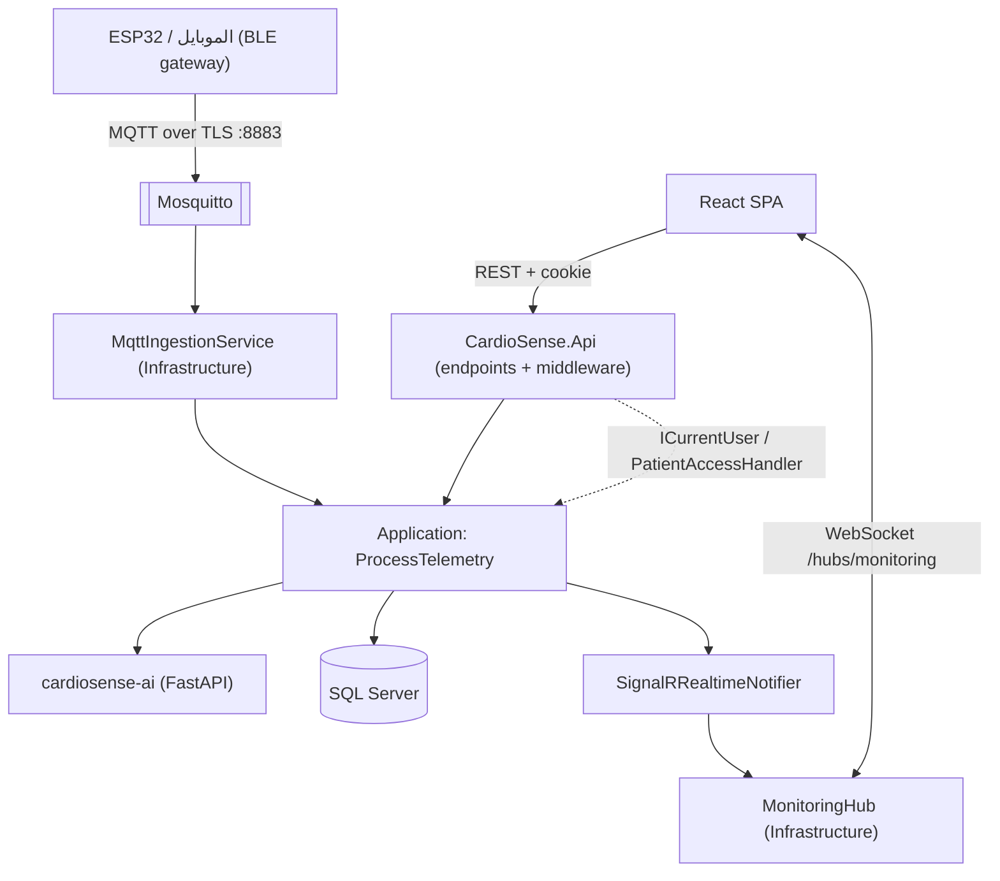
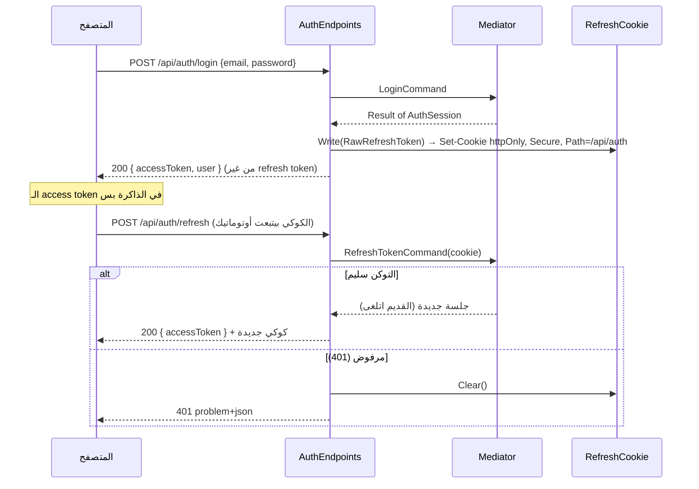

# تقرير التسليم النهائي — CardioSense Backend (الربع الرابع والأخير: Api + tests + AI + Docker)
**تاريخ:** 9 نوفمبر 2026
**الغرض من الملف ده:** إن أي حد يقراه يفهم الجزء الأخير من الباك كأنه هو اللي كاتب الكود: كل فولدر بيعمل إيه، كل ملف جواه إيه وشغلته إيه، وإزاي كل حاجة بتتوصل بالأجزاء اللي اتسلّمت قبل كده (`BACKEND_REPORT.md` للـ Domain + Application، و `INFRASTRUCTURE_REPORT.md` للـ Infrastructure). وبعد التقرير ده **الباك كله خلص**: مفيش حاجة فاضلة غير التشغيل الحقيقي (§11).

---

## 1. ملخص سريع

- اتبنى **مشروع الـ Api كامل** (34 ملف C#)، و**3 مشاريع اختبارات** (40 ملف C#)، و**خدمة الـ AI** (Python FastAPI)، و**`docker-compose.yml`** + Dockerfile للـ API وللـ AI + إعدادات الـ MQTT broker بـ TLS.
- الحل كله دلوقتي = **7 مشاريع C# · 239 ملف · ≈ 12,320 سطر** (عدّيتهم بـ `wc -l` على كل ملفات `.cs`) + **11 ملف Python · ≈ 737 سطر**.
- الاختبارات: **150 حالة اختبار C#** (Application.Tests = 76، Infrastructure.Tests = 48، Api.IntegrationTests = 26) + **30 اختبار Python**.
- الـ 22 use case كلهم متوصّلين: **20 عن طريق REST (24 route)** و**2 عن طريق الـ MQTT worker** (اتفحص آليًا: مفيش use case من غير نقطة دخول — §11).
- **اتعدّل في الكود القديم 3 حاجات صغيرة بس** (§3): شلت الـ AI flags من نص الـ Alert اللي المريض بيشوفه، وأضفت كاشف تكرار المفتاح الفريد + `EnsureCreated` في الـ Infrastructure، وأضفت أرقام الحزم الجديدة وملفات الـ solution.
- **مهم وصريح:** مفيش .NET SDK ولا Docker ولا إنترنت في الـ sandbox. يعني **ماعملتش `dotnet build` ولا `dotnet test` ولا `docker compose up`**، والاختبارات مكتوبة بس **لسه ماتشغّلتش**. اللي اتشغّل فعلًا: فحص ثابت على 239 ملف (§11) و30 اختبار Python (22 اتنفّذوا فعلًا، و8 بتاعة الـ HTTP اتخطّوا لأن FastAPI مش متسطّب). **أول حاجة تعملها: `dotnet build` ثم `dotnet test`** (§12).

---

## 2. خريطة الباك كله (إزاي الأجزاء بتتوصل)



| المشروع | بيعمل إيه | اتسلّم في |
|---|---|---|
| `CardioSense.Domain` | قواعد الشغل الصافية | البداية |
| `CardioSense.Application` | الـ 22 use case + العقود (interfaces) + الـ pipeline | البداية |
| `CardioSense.Infrastructure` | تنفيذ العقود: EF Core، Identity/JWT، MQTT، SignalR، HTTP للـ AI | الربع التالت |
| **`CardioSense.Api`** | **الـ HTTP host: endpoints، auth، CORS، audit، error shape** | **الربع الرابع** |
| **`tests/` (3 مشاريع)** | **اختبارات الـ Domain والـ Application والـ Infrastructure والـ Api** | **الربع الرابع** |
| **`cardiosense-ai`** | **خدمة التصنيف + نص التقرير (Python)** | **الربع الرابع** |
| **`docker-compose.yml`** | **تشغيل المنظومة كلها بأمر واحد** | **الربع الرابع** |

قاعدة الاعتماد لسه زي ما هي: `Api → Infrastructure → Application → Domain` (الـ Api بس هو اللي بيشوف الكل لأنه الـ composition root).

---

## 3. اللي اتعدّل في الكود القديم (وليه)

| # | الملف | التعديل | السبب |
|---|---|---|---|
| 1 | `Application/.../ProcessTelemetryHandler.cs` | شلت الـ AI `Flags` من نص `Alert.Message` (سطرين + تحديث توثيق) | ملاحظة §9 في تقرير الـ Infrastructure: الـ flags **doctor-only** والـ Message بيوصل للمريض (قايمة التنبيهات + الـ push). الـ flags لسه بتوصل للدكتور في الـ `riskStatus` الإكلينيكي. عليها اختبار (`ProcessTelemetryTests`). |
| 2 | `Infrastructure/Persistence/UniqueViolation.cs` (**جديد**) | كاشف: هل فشل الحفظ بسبب unique index (SQL error 2601/2627)؟ | لو مريضين سجّلوا بنفس الرقم القومي في نفس اللحظة، الـ index بيمنع التاني بـ `DbUpdateException` — والـ Api بيحوّلها لـ **409** بدل 500. المعرفة بـ SQL Server مكانها الـ Infrastructure مش الـ Api. |
| 3 | `Infrastructure/Persistence/DatabaseInitializer.cs` | أضفت `EnsureCreatedAsync` | الـ migration الأولى لسه مش متولّدة (محتاجة `dotnet ef`). من غيره docker-compose والـ integration tests هيبدأوا على داتا بيز فاضية. |
| 4 | `Infrastructure.csproj` | `InternalsVisibleTo` لمشروع `CardioSense.Infrastructure.Tests` | عشان الاختبارات توصل لـ `TelemetryMessageParser` و`HttpRiskAssessmentService` (internal). |
| 5 | `Directory.Packages.props` | حزم الـ Api والاختبارات (§10) | — |
| 6 | `CardioSense.sln` | اتضاف الـ Api و3 مشاريع الاختبارات (في فولدر `tests`) | — |
| 7 | `Api/Hubs/` | اتمسح (كان فاضي) | الـ hub في الـ Infrastructure (قرار #1 في تقرير الـ Infrastructure، وانت وافقت) — الـ Api بيعمل `MapHub` بس. |

---

## 4. مشروع الـ Api — شرح فولدر فولدر

```
CardioSense.Api/
├── CardioSense.Api.csproj           # Web SDK؛ بيشاور على Domain/Application/Infrastructure + JwtBearer + OpenApi + HealthChecks.EF
├── Program.cs                       # نقطة الدخول: 4 مراحل بس (سجّل الطبقات، جهّز الداتا بيز، ابني الـ pipeline، اعمل map للـ endpoints)
├── DependencyInjection.cs           # AddApi(): كل تسجيلات الـ Api في مكان واحد
├── WebApplicationExtensions.cs      # UseApi() (ترتيب الـ middleware) + InitializeDatabaseAsync()
├── appsettings.json / .Development.json / Properties/launchSettings.json
├── Authentication/                  # مين المتصل؟
├── Authorization/                   # إيه المسموح له؟
├── Endpoints/                       # الـ routes (ملف لكل مجال)
├── Contracts/                       # أجسام الطلبات اللي مينفعش تتربط بـ command مباشرة
├── Http/                            # ترجمة Result → HTTP + فلتر الـ Origin
├── Middleware/                      # exception handler، security headers، audit
└── Options/                         # الإعدادات (CORS، cookie، rate limit، database)
```

### 4.1 الجذر

| الملف | بيعمل إيه وليه |
|---|---|
| `Program.cs` | بيسجّل `AddApplication()` **الأول** (لأنه بيسجّل `TimeProvider` اللي الـ Infrastructure محتاجه) ثم `AddInfrastructure(config)` ثم `AddApi()`؛ بعدين `InitializeDatabaseAsync` و`UseApi` و`MapEndpointGroups`. مفيش route واحد مكتوب هنا — endpoint جديد = كلاس جديد بس. آخر الملف `public partial class Program;` عشان integration tests تقدر تشغّل الـ API في الميموري. |
| `DependencyInjection.cs` | `AddApi()` بيقسم شغله على 4 دوال: **الإعدادات** (مربوطة ومتحقق منها وقت التشغيل `ValidateOnStart` فأي قيمة ناقصة توقف التطبيق برسالة واضحة)، **الأمان** (JWT + الـ policies + `CurrentUser` + فلتر الـ hub + الـ cookie)، **وصول المتصفح** (CORS + rate limit — الاتنين بيقروا من الإعدادات)، **سلوك الـ HTTP** (JSON enums بالأسماء، ProblemDetails، exception handler، health checks، OpenAPI). |
| `WebApplicationExtensions.cs` | `UseApi()` — **الترتيب مهم ومكتوب مرة واحدة**: `ExceptionHandler` → `StatusCodePages` → `SecurityHeaders` → `Routing` → `Cors` → `RateLimiter` → `Authentication` → `Authorization` → `AuditLogging` → الـ endpoints. و`InitializeDatabaseAsync()`: حسب `Database:Initialization` (`None` / `Migrate` / `EnsureCreated`) ثم بذر 10 أجهزة تجريبية **في الـ Development بس**. |
| `appsettings.json` | قيم افتراضية آمنة **من غير أي سر**: الـ `Jwt:SigningKey` فاضي والـ connection string مش موجود (التطبيق مش هيشتغل من غيرهم — قصد). `Cors:AllowedOrigins` فاضي → التشغيل بيفشل لحد ما تحدد الـ frontend. |
| `appsettings.Development.json` | LocalDB (من غير باسورد)، CORS لـ `localhost:5173/4173`، الـ MQTT مقفول، `Database:Initialization=EnsureCreated`. |
| `Properties/launchSettings.json` | `https://localhost:5001` و`http://localhost:5000` (زي `.env.example` بتاع الفرونت) و`TZ=Africa/Cairo`. |

### 4.2 `Authentication/`

| الملف | الشرح |
|---|---|
| `CurrentUser.cs` | تنفيذ `ICurrentUser`: بيقرا `sub` و`role` و`patientId` و`doctorId` من الـ claims بأسمائها الخام (نفس ثوابت `JwtClaimNames` اللي الـ token service كتب بيها). claim ناقص أو بايظ = `null` مش exception. Scoped. بيقبل مستخدم يتحط من برّه (`UsePrincipal`) للـ hub. |
| `CurrentUserHubFilter.cs` | **بيحل مشكلة اتذكرت في تقرير الـ Infrastructure (#5):** جوه method في الـ SignalR hub مفيش ضمان إن `HttpContext` موجود (بيعتمد على الـ transport — في long polling كل رسالة طلب HTTP منفصل). الفلتر بيدّي `CurrentUser` المستخدم بتاع الاتصال قبل كل استدعاء، فـ `JoinPatientGroup` بيشتغل صح على أي transport. عليه اختبار تكامل بـ long polling. |
| `JwtBearerSetup.cs` | بيظبط تحقق الـ access token **مطابق لـ `JwtTokenService`**: نفس الـ issuer/audience والمفتاح (HS256 بس)، `MapInboundClaims=false`، `ClockSkew` 30 ثانية. وعشان المتصفح مبيقدرش يبعت Authorization header على WebSocket، بيقبل التوكن من `?access_token=` **لمسار الـ hub بس**. |
| `RefreshCookie.cs` | بيكتب/يقرا/يمسح كوكي الـ refresh. **كل ما يخص الأمان ثابت هنا:** `HttpOnly` و`Secure` دايمًا، `Path=/api/auth` (الكوكي مش بيتبعت مع كل طلب)، الانتهاء = انتهاء التوكن المخزّن، و`SameSite` من الإعدادات. المسح لازم يكرر نفس الـ Path والـ SameSite وإلا المتصفح بيسيب الكوكي. |

### 4.3 `Authorization/`

| الملف | الشرح |
|---|---|
| `AuthorizationPolicies.cs` | `PatientOnly` = مصدّق + role=Patient + claim `patientId`، و`DoctorOnly` = مصدّق + role=Doctor + claim `doctorId`. |
| `PatientAccessRequirement.cs` | requirement من غير بيانات؛ المريض هو الـ resource. |
| `PatientAccessHandler.cs` | **adapter رفيع** (زي ما اتفقنا) فوق `IPatientAccessChecker`: السؤال "هل المتصل يشوف المريض ده؟" ليه مكان واحد بس (الـ Application). الـ handler ده بس بيسمح للـ HTTP يسأل نفس السؤال. |
| `PatientAccessFilter.cs` | endpoint filter مرة واحدة على جروب `/api/patients/{id}` فمفيش endpoint يقدر ينسى الفحص. دكتور مش متعيّن له المريض = **403** قبل ما الطلب يوصل للـ mediator (والـ mediator بيفحص تاني: دفاع على طبقتين، ومستحيل يختلفوا لأن الاتنين بيسألوا نفس الـ checker). |

### 4.4 `Endpoints/` (24 route — الجدول الكامل في §6)

| الملف | الشرح |
|---|---|
| `IEndpointGroup.cs` + `EndpointExtensions.cs` | كل مجال كلاس بيعمل map لنفسه، والـ reflection بيلاقيهم ويسجّلهم. ده اللي بيخلي `Program.cs` مايتغيرش. |
| `ApiRoutes.cs` | ثوابت مشتركة: مسار الـ hub (بيستخدمه الـ map وكمان `JwtBearerSetup`) واسم الـ rate-limit policy. |
| `AuthEndpoints.cs` | `/api/auth/*`. الـ handler بيبعت الـ command ثم **بيقسم `AuthSession`**: الـ refresh token الخام للكوكي، والباقي JSON. `refresh` لو اترفض بـ 401 بيمسح الكوكي. `logout` بيمسح الكوكي دايمًا (idempotent). الـ login والـ signup عليهم rate limit؛ كل الجروب عليه فلتر الـ Origin. |
| `PatientEndpoints.cs` | `/me` (مريض بس) و`/{id}` (دكتور متعيّن بس). كل قراءة موجودة مرتين بنفس المنطق: نسخة `/me` بتجيب الـ id من التوكن وبتنده نسخة `/{id}`. الأفعال الإكلينيكية (manual event، freeze، resolve) **موجودة تحت `/{id}` بس** — كده بتفضل مخفية عن المريض. الجروبين عليهم audit. |
| `DoctorEndpoints.cs` | `/api/doctors/me/*` — كله doctor-only ومتحدد بالمتصل. القيم الافتراضية للقايمة (`status=all`, `page=1`, `pageSize=5`) من الـ Application مش من هنا. |
| `DeviceEndpoints.cs` | `pair` و`{serial}/status` — مفتوحين لأي مستخدم مصدّق (الاتنين بيستخدموهم)؛ الـ handlers هي اللي بتقرر، وجهاز مش بتاعك = 404 (مفيش تخمين للأرقام التسلسلية). |
| `HealthEndpoints.cs` | `/health/live` (العملية شغالة) و`/health/ready` (+ الاتصال بالداتا بيز). من غير بيانات مرضى. |
| `MonitoringHubEndpoints.cs` | `MapHub<MonitoringHub>("/hubs/monitoring")`. |
| `OpenApiEndpoints.cs` | `/openapi/v1.json` **في الـ Development بس** — أسرع طريقة تراجع بيها عقد الـ API مع الفرونت. |

### 4.5 `Contracts/`
`PatientRequests.cs`: أجسام `UpdatePatientProfileRequest` و`LogManualEventRequest` و`FreezeWaveformRequest` و`ResolveAlertRequest`. **ليه مش بنربط الـ command مباشرة؟** لأن الـ command فيه `PatientId` ولازم ييجي من الـ URL أو التوكن، مش من جسم الطلب (وإلا مستخدم يقدر يبعت id مريض تاني). الباقي (signup/login/pair/assign/doctor update) بيتربط على الـ commands مباشرة لأنها مفيهاش هوية.

### 4.6 `Http/`
| الملف | الشرح |
|---|---|
| `ResultHttpExtensions.cs` | **المكان الوحيد** اللي `ErrorType` بيتحول فيه لـ HTTP: Failure 422 · Validation 400 · Unauthorized 401 · Forbidden 403 · NotFound 404 · Conflict 409 · Unavailable 503. كل خطأ = `ProblemDetails` فيه `title/status/detail` + `code` ثابت (مثلًا `Patient.NationalIdTaken`)، وأخطاء الـ validation فيها كمان `errors` (أسماء الحقول camelCase عشان الفرونت تربطها بالـ inputs). |
| `ApiErrors.cs` | الخطأين اللي الـ HTTP بس هو اللي بيطلّعهم: `Database.UniqueViolation` و`Request.OriginNotAllowed`. |
| `AllowedOriginFilter.cs` | **حماية CSRF** على `/api/auth/*`: المتصفح بيبعت الكوكي أوتوماتيك حتى لو الطلب جاي من موقع تاني، وبيبعت `Origin` دايمًا في الـ POST المتقاطع. أي `Origin` مش في قايمة CORS = **403**. طلب من غير `Origin` (curl، سيرفر) بيعدّي. نفس القايمة بتاعة CORS فمش ممكن يختلفوا. |

### 4.7 `Middleware/`
| الملف | الشرح |
|---|---|
| `GlobalExceptionHandler.cs` | آخر خط دفاع. مكسر unique index (سباق) → **409** بنفس شكل الأخطاء. أي exception تاني → **500 عام** من غير تفاصيل للعميل (التفاصيل في اللوج). عميل فصل في نص الطلب = مش خطأ. |
| `SecurityHeadersMiddleware.cs` | `Cache-Control: no-store` (بيانات مرضى — مينفعش تتخزّن في متصفح ولا proxy) + `nosniff` + `no-referrer` على كل رد، حتى ردود الأخطاء. |
| `PatientAuditMetadata.cs` | علامة بتتحط على الـ route groups اللي بتلمس ملف مريض. |
| `AuditLoggingMiddleware.cs` | بيكتب صف في `AuditLogs` لكل طلب على ملف مريض: **مين + إيه + حالة الرد + IP + امتى**. بيتكتب **بعد** معرفة الـ status فالمحاولات المرفوضة (403) بتتسجل كمان — وده بالظبط اللي التحقيق محتاجه. المريض = الـ `{id}` في الـ URL أو `patientId` بتاع المتصل في `/me`. فشل كتابة الصف بيتسجل في اللوج ومبيغيّرش الرد. |

### 4.8 `Options/`
`ApiCorsOptions` · `RefreshCookieOptions` (الاسم، الـ Path، `SameSite`) · `RateLimitOptions` · `DatabaseOptions` + `DatabaseInitialization` (`None/Migrate/EnsureCreated`). كلهم بيتربطوا من الـ configuration ويتحقق منهم وقت التشغيل.

---

## 5. رحلات الطلبات

### 5.1 تسجيل الدخول والتجديد


### 5.2 قراءة ملف مريض بواسطة دكتور
`SecurityHeaders` → `Routing` → `CORS` → `Authentication` (JWT) → `Authorization` (policy `DoctorOnly`) → **`PatientAccessFilter`** (متعيّن؟ لا → 403) → handler → `AuthorizationBehavior` + `ValidationBehavior` (في الـ Application) → قراءة الداتا بيز → رد → **`AuditLogging` يكتب الصف** (حتى لو 403).

### 5.3 اتصال الـ SignalR
المتصفح يتصل بـ `/hubs/monitoring?access_token=…` → `JwtBearerSetup` يقبل التوكن (للـ hub بس) → المريض يدخل جروبه تلقائيًا، الدكتور ينده `JoinPatientGroup(patientId)` → `CurrentUserHubFilter` يدّي `CurrentUser` المستخدم → `IPatientAccessChecker` يفحص → رفض = `HubException("…not allowed…")`.

---

## 6. جدول الـ routes

| الطريقة والمسار | مين يقدر | الـ use case | الرد |
|---|---|---|---|
| `POST /api/auth/signup/patient` | عام (rate limit) | RegisterPatient | 200 + كوكي |
| `POST /api/auth/signup/doctor` | عام (rate limit) | RegisterDoctor | 200 + كوكي |
| `POST /api/auth/login` | عام (rate limit) | Login | 200 + كوكي |
| `POST /api/auth/refresh` | الكوكي (+ فحص Origin) | RefreshToken | 200 / 401 |
| `POST /api/auth/logout` | الكوكي (+ فحص Origin) | Logout | 204 |
| `GET /api/patients/me` | مريض | GetPatientProfile | 200 |
| `PUT /api/patients/me` | مريض | UpdatePatientProfile | 200 |
| `GET /api/patients/me/vitals-history?range=` | مريض | GetPatientVitalsHistory | 200 |
| `GET /api/patients/me/alerts` | مريض | GetPatientAlerts | 200 |
| `GET /api/patients/me/ai-report?period=` | مريض | GetPatientAiReport | 200 |
| `GET /api/patients/{id}` (+ `/vitals-history` `/alerts` `/ai-report`) | دكتور متعيّن | نفس الأربعة | 200 |
| `POST /api/patients/{id}/manual-events` | دكتور متعيّن | LogManualEvent | **201** |
| `POST /api/patients/{id}/freeze-waveform` | دكتور متعيّن | FreezeWaveform | **204** |
| `POST /api/patients/{id}/alerts/{alertId}/resolve` | دكتور متعيّن | ResolveAlert (**جديد**) | 200 |
| `GET` / `PUT /api/doctors/me` | دكتور | GetDoctorProfile / UpdateDoctorProfile | 200 |
| `GET /api/doctors/me/patients?status=&search=&page=&pageSize=` | دكتور | GetMyPatients | 200 |
| `POST /api/doctors/me/patients` | دكتور | AssignDoctor | 200 |
| `GET /api/doctors/me/ward-stats` | دكتور | GetWardStats | 200 |
| `POST /api/devices/pair` | مريض أو دكتور | PairDevice | 200 |
| `GET /api/devices/{serial}/status` | مريض (جهازه) أو دكتور (مريضه) | GetDeviceStatus | 200 |
| `/hubs/monitoring` | مصدّق | — | WebSocket / long polling |
| `GET /health/live` · `/health/ready` | عام | — | 200 |
| `GET /openapi/v1.json` | Development بس | — | 200 |

الـ 22 use case: 20 من الجدول + `ProcessTelemetry` و`ProcessDeviceStatus` (من الـ MQTT).

---

## 7. الاختبارات (3 مشاريع)

> **اتكتبوا ولسه ماتشغّلوش** (مفيش SDK). الأوامر في §12. أي فشل في أول تشغيل غالبًا هيكون في توقيع API لمكتبة، مش في المنطق.

### 7.1 `CardioSense.Application.Tests` — 76 حالة، من غير داتا بيز ولا شبكة
الفكرة: اختبارات الـ use cases بتعدّي على **الـ pipeline الحقيقي** (`AddApplication()` → authorization → validation → handler) فوق EF in-memory، وكل حاجة كانت هتيجي من الـ Infrastructure اتبدلت بـ fake مكتوب بإيدي.

| الفولدر / الملف | بيغطي |
|---|---|
| `Support/ApplicationTestHost` | بيبني الـ Application الحقيقي + الـ fakes (متسجّلين **بعد** `AddApplication` فيكسبوا). `SendAsync` = زي طلب HTTP، `SeedAsync`/`QueryAsync` للداتا. |
| `Support/` الباقي | `TestDbContext` (IAppDbContext فوق in-memory) · `FakeCurrentUser` (تسجّل دخول كمريض/دكتور) · `RecordingNotifier` (بيسجّل الـ pushes) · `StubRiskAssessmentService` (بتقرر إجابة الـ AI) · `InMemoryVitalsStore` · `StubIdentityService` · `StubTokenService` · `FixedTimeProvider` · `Seed` |
| `Entities/AlertTests` | الـ Critical مبيتقفلش إلا بدكتور · مبيتقفلش مرتين · الـ Moderate بيتقفل أوتوماتيك |
| `Entities/RiskAssessmentTests` | **قفل الـ Critical**: النموذج لو قال Stable والـ latch شغّال يتخزن Critical + `critical_latched` · الثقة والسكور برّه المدى مرفوضين · تنضيف الـ flags |
| `Entities/DeviceTests` · `VitalsSampleTests` · `RefreshTokenTests` · `PatientTests` · `ResultTests` | الربط بمريض واحد · "آخر ظهور" مبيرجعش لورا · حدود النبض (20–300) والأكسجين (50–100) على الجهتين · **مهلة الـ 10 ثواني** (تابين) مقابل السرقة · السن ↔ تاريخ الميلاد · `Result` مبيدّيش قيمة لو فشل |
| `Pipeline/AuthorizationPipelineTests` | دكتور غير متعيّن = Forbidden · متعيّن = تمام · مريض يشوف نفسه بس · مجهول = Forbidden |
| `Pipeline/ValidationPipelineTests` | الأخطاء على الحقل الصح بأسماء camelCase (`note`, `nationalId`) · تسجيل مرفوض مبيعملش مريض |
| `Pipeline/ProcessTelemetryTests` | جهاز مجهول/غير مربوط مرفوض · قراءة عادية بتتخزن وتتبعت وتتقيّم · الـ AI بيستلم السن والـ features · **Critical = تنبيه واحد مش واحد لكل قراءة، ومفيهوش الـ flags، والمريض مبيستلمش الثقة/السكور/الـ flags في الـ push** · الـ AI واقع = القراءة بتتحفظ من غير تقييم · **Critical يفضل لحد ما دكتور يحل التنبيه** · Caution بعد Stable = Moderate وبيتقفل لما يرجع Stable · وقت مستقبلي مرفوض |
| `Pipeline/RegisterPatientTests` | إنشاء الحساب والملف والتاريخ المرضي والجلسة · رقم قومي مكرر = Conflict · اسم دكتور فريد = ربط primary، **اسم مكرر = من غير ربط** · جهاز حر = بيتربط |
| `Pipeline/RefreshTokenPipelineTests` | التدوير · قبول توكن اتلغى من ثواني · **توكن اتلغى من فترة = سرقة = كل الجلسات تتلغي** · توكن مجهول/فاضي |
| `Pipeline/PairDeviceTests` · `GetMyPatientsTests` | جهاز من المخزون بس · مريض = جهاز واحد · جهاز مربوط بمريض تاني = Conflict · دكتور لازم يحدد المريض · **قايمة الدكتور = مرضاه بس** + بحث + المريض مش بيشوف القايمة |

### 7.2 `CardioSense.Infrastructure.Tests` — 48 حالة (مشروع **إضافي** عن الـ architecture doc)
ليه مشروع تالت؟ لأن الـ parser والـ HTTP client للـ AI أنضف حاجات في الـ Infrastructure للاختبار، ومينفعش أحطهم في Application.Tests من غير ما أكسر قاعدة الاتجاه.

| الملف | بيغطي |
|---|---|
| `Ingestion/TelemetryMessageParserTests` | **عقد الـ firmware**: الـ serial من الـ topic **بس** (مفيش انتحال) · حقل ناقص بيتبلّغ عنه **بالاسم** (مش بيتحول لـ 0) · أرقام صحيحة بس (`74.5` مرفوضة) · topics غلط مرفوضة · connectionMode غلط ورقم مرفوضين |
| `AiClient/HttpRiskAssessmentServiceTests` | بـ fake HTTP handler: إجابة سليمة · شكل الطلب (`/analyze`, `qtQtcMs:[396,418]`) · **أي إجابة مش صالحة = Unavailable** (من غير status / status مجهول / رقم بدل اسم / مش JSON / 500 / انقطاع) — عمره ما بيفترض "Stable" · تقرير: نص بيتقص، فاضي مرفوض |
| `Identity/JwtTokenServiceTests` | الـ claims الصح للدكتور والمريض · الانتهاء بعد 15 دقيقة · التوقيع صالح للمفتاح المضبوط بس · الـ refresh token طويل وURL-safe ومميز والـ hash ثابت |
| `Identity/IdentityErrorsTests` | تحويل أخطاء Identity: إيميل مكرر = Conflict، باسورد ضعيف/إيميل غلط = Validation على الحقل |
| `Persistence/PersistenceModelTests` | **بيبني الـ EF model من غير داتا بيز** ويتأكد: الـ unique indexes (الرقم القومي، الرخصة، الـ serial، الـ token hash، جهاز-لمريض، تعيين دكتور) · **مفيش cascade delete** على جداول الدومين · الـ enums مخزنة نص · أسماء الجداول زي التصميم · عمود `ContributingFactorsJson` · الـ sequence بتاع رقم الملف |
| `Persistence/UniqueViolationTests` | الكاشف مبيدّعيش أخطاء عادية (الحالة الإيجابية محتاجة `SqlException` حقيقي فاتغطت في التكامل) |

### 7.3 `CardioSense.Api.IntegrationTests` — 26 حالة (محتاجة Docker)
بتشغّل **الـ API الحقيقي في الميموري فوق SQL Server حقيقي** في container مؤقت (Testcontainers). الـ AI بس هو اللي fake. الإعدادات بتتبعت **كمتغيرات بيئة** لأنها بتكسب على ملفات `appsettings` وبتتقرا قبل `Program.cs` — فمسار الإقلاع الحقيقي (EnsureCreated + الأجهزة التجريبية) بيتجرب.

| الملف | بيغطي |
|---|---|
| `Support/` | `ApiFactory` (الـ container + الإعدادات) · `ApiCollection` (container واحد للكل) · `Accounts` (بتعمل مرضى ودكاترة من خلال endpoints الـ signup الحقيقية، بقيم فريدة) · `StubAiService` |
| `HealthAndErrorShapeTests` | `/health/live` و`/ready` · 401 + `no-store` + `nosniff` · **400 بـ `errors.nationalId`** · 404 بـ `code` ثابت |
| `AuthFlowTests` | الكوكي: `HttpOnly; Secure; Path=/api/auth; SameSite=Strict` **والتوكن مش في الـ body** · التجديد من الكوكي لوحدها · من غير كوكي = 401 · **Origin غريب = 403** والـ Origin المسموح = 200 · logout بيقفل الجلسة · login صح/غلط · رقم قومي مكرر = 409 بـ `Patient.NationalIdTaken` |
| `AccessControlTests` | مريض يقرا نفسه · **دكتور 403 قبل التعيين و200 بعده** · قايمة الدكتور = مرضاه · مريض مينفعش يستخدم endpoints الدكتور ولا يسجل manual event · الدكتور يسجّل حدث (201) والمريض يشوفه · **كل وصول لملف مريض — حتى المرفوض — ليه صف audit** |
| `DevicePairingTests` | ربط جهاز تجريبي وقراءة حالته · جهاز بتاع مريض تاني = 409 · حالة جهاز غيرك = 404 |
| `MonitoringHubTests` | اتصال حقيقي بـ long polling: **دكتور متعيّن يدخل جروب المريض · غير متعيّن = `HubException` · توكن بايظ مرفوض** (بيثبت إن `CurrentUserHubFilter` شغّال) |

---

## 8. خدمة الـ AI — `cardiosense-ai/`

> **حقيقة لازم تتقال بوضوح:** مفيش موديل متدرّب. اللي اتبنى **مصنّف قواعد شفاف (prototype)** — عتبة لكل قياس، كلها مكتوبة في جدول `RULES` عشان طبيب يقراها ويعدّلها. العتبات مرجعية شائعة للبالغين وده **افتراض يحتاج مراجعة إكلينيكية**. الـ `confidenceScore` تقدير إرشادي ("في قيمة جنب عتبة؟")، مش احتمال إحصائي. الاسم المرسل `rules-v0.1-prototype` عشان الواجهة والـ AI Report يفضلوا صادقين ("AI-Assisted Insights (Prototype)").

```
cardiosense-ai/
├── app/
│   ├── main.py                  # FastAPI: GET /health · POST /analyze · POST /report (طبقة رفيعة)
│   ├── schemas.py               # عقد الـ JSON مع .NET (camelCase) بـ Pydantic v2
│   ├── inference.py             # الفاصل: main.py مبيستورد موديل بعينه، بيطلب مصنّف من هنا
│   ├── report.py                # نص التقرير: بيعيد صياغة الأرقام المبعوتة بس (مفيش اختراع)
│   └── models/risk_classifier.py # المصنّف (Python نقي، من غير مكتبات)
├── tests/                       # 30 اختبار unittest
├── training/{notebooks,datasets}/ # لسه فاضيين (التدريب مرحلة جاية)
├── requirements.txt · requirements-dev.txt · Dockerfile · .dockerignore · .gitignore · README.md
```

| القاعدة (flag) | Caution | Critical |
|---|---|---|
| `tachycardia` (نبض أعلى من) | 110 | 150 |
| `bradycardia` (نبض أقل من) | 50 | 40 |
| `low_spo2` (أقل من) | 94 % | 90 % |
| `prolonged_pr` (أعلى من) | 200 ms | 300 ms |
| `short_pr` (أقل من) | 120 ms | — |
| `wide_qrs` (أعلى من) | 120 ms | 160 ms |
| `prolonged_qtc` (أعلى من) | 460 ms | 500 ms |

- **الحالة** بتيجي من القراءات بس (أسوأ finding). **السكور:** Caution = 25 نقطة، Critical = 60، + حتى 10 للسن ≥ 65 وتاريخ قلب معروف (**السياق مستحيل يغيّر الحالة لوحده**)، والمجموع ≤ 100.
- **الثقة:** 0.95، وتنزل 0.15 لو أي قيمة جنب عتبة (هامش لكل قاعدة بوحدتها: 5 نبضات، 1% أكسجين، 10 ms…).
- **العقد** مطابق لـ `AiContracts.cs` (في الـ Infrastructure) و§7.2 من تقرير الـ Infrastructure: `statusLevel` literal من 3 قيم بس، فمستحيل الخدمة تطلّع قيمة الـ .NET هيرفضها.
- **الأمان:** الخدمة **مفيهاش authentication** وده قصد: ممنوع تتفتح للإنترنت (compose مبيعملش publish للبورت بتاعها).

---

## 9. `docker-compose.yml` وملفاته

| الخدمة | الشرح |
|---|---|
| `sqlserver` | SQL Server 2022 + healthcheck (`sqlcmd`)، بورت `14330` للأدوات المحلية، volume دائم. |
| `certs` | job لمرة واحدة بيعمل CA وشهادة للـ broker (`generate-dev-certs.sh`، idempotent، ومبيسيبش مفتاح الـ CA). |
| `mosquitto` | TLS بس على 8883، **من غير anonymous**، ملف الباسورد بيتبني وقت التشغيل من متغيرات البيئة (مفيش credential في الـ repo). |
| `ai` | بيتبني من `../cardiosense-ai`، **من غير بورت منشور**. |
| `api` | بيستنى SQL healthy + AI healthy؛ `ASPNETCORE_ENVIRONMENT=Development` (أجهزة تجريبية)، `Database__Initialization=EnsureCreated`، `SSL_CERT_FILE` عشان .NET يثق في الـ CA بتاع الـ dev، بورت `5000`. |
| `redis` | **تحت `profiles: [phase2]`** — محجوز للـ SignalR backplane وكاش آخر قراءة. **مفيش كود بيتصل بيه لسه**، فمش بيشتغل افتراضيًا. |

- الأسرار من `.env` (انسخه من `.env.example`)؛ compose **بيرفض يشتغل** لو ناقص `SQLSERVER_SA_PASSWORD` أو `JWT_SIGNING_KEY` أو `MQTT_PASSWORD`.
- `Dockerfile` (الـ API): مرحلتين؛ الـ `restore` من ملفات الـ `.csproj` الأول (cache)، والـ runtime بيشتغل بمستخدم غير root، و`TZ=Africa/Cairo`.
- **حدود متعمدة (مش للإنتاج):** شهادات self-signed، مستخدم MQTT واحد مشترك (الإنتاج يحتاج credential لكل جهاز + ACL على `devices/<serial>/#`)، حساب `sa`، وبيئة Development.
- Safari مبيقبلش كوكي `Secure` على `http://localhost` (Chrome و Firefox بيقبلوا) — لو الفرونت على Safari استخدم HTTPS.

---

## 10. الحزم الجديدة (`Directory.Packages.props`)

| الحزمة | الإصدار | مين بيستخدمها |
|---|---|---|
| `Microsoft.AspNetCore.Authentication.JwtBearer` | 10.0.0 | Api |
| `Microsoft.AspNetCore.OpenApi` | 10.0.0 | Api |
| `Microsoft.Extensions.Diagnostics.HealthChecks.EntityFrameworkCore` | 10.0.0 | Api |
| `Microsoft.NET.Test.Sdk` / `xunit` / `xunit.runner.visualstudio` / `coverlet.collector` | 17.14.1 / 2.9.3 / 3.1.4 / 6.0.4 | الاختبارات |
| `Microsoft.EntityFrameworkCore.InMemory` | 10.0.0 | Application.Tests |
| `Microsoft.AspNetCore.Mvc.Testing` · `Microsoft.AspNetCore.SignalR.Client` | 10.0.0 | Api.IntegrationTests |
| `Testcontainers.MsSql` | 4.7.0 | Api.IntegrationTests |

**الأرقام دي من معرفتي مش من restore حقيقي** — لو `dotnet restore` اشتكى غيّر الرقم في الملف ده بس (مكان واحد).

---

## 11. التحقق والاختبار — بصراحة

### 11.1 اللي اتعمل فعلًا
1. **الفحص الثابت** (`back-verification-toolkit`) اتوسّع ليشمل الـ Api والـ 3 مشاريع اختبارات: **239 ملف · 22 request = 22 handler · 15 validator · صفر مشاكل**. بيفحص: الأقواس، الهيدر، الـ namespace = مسار الفولدر، الـ `using` (ناقص/زايد/مش مترتب/اعتماد على طبقة برّه)، توثيق كل member، الـ wiring، الأعضاء الميتة، تصادم الأسماء، `async` من غير `await`، أنواع `Result`، الأسطر > 120 والـ tabs والـ TODO.
2. **اختبار الأداة نفسها:** حقنت **8 عيوب مقصودة** في نسخة منفصلة (using ناقص، namespace غلط، توثيق ناقص، using زايد، اعتماد Domain على Api، `async` من غير await، سطر أطول من 120 حرف، متغير غلط الكتابة `cct`) — **كلهم اتكشفوا**. ولقيت **كام false positive** في الأداة نفسها لما وسّعتها (lambdas بـ `async`، raw strings، `[InlineData("…")]`، أسماء أعضاء anonymous types) واتصلّحوا في الأداة قبل ما أعتمد على نتايجها.
3. **فحوصات تقاطع (cross-checks) بسكريبتات:**
   - **كل الـ 22 request** مستخدمين من endpoint أو من الـ MQTT parser (مفيش use case يتيم).
   - كل ثوابت `ApplicationErrors` و`DomainErrors` و`ContractLiterals` اللي الـ Api والاختبارات بتشاور عليها **موجودة فعلًا** في تعريفاتها.
   - الأعضاء اللي الاختبارات بتستخدمها على الكيانات والـ DTOs (≈ 90 عضو) **موجودة** في ملفاتها، وترتيب حقول الـ commands المستخدمة في الاختبارات مطابق للـ records.
   - **مفاتيح الإعدادات**: كل مفتاح في `appsettings` وفي `docker-compose` وفي الـ integration tests بيطابق property حقيقية في كلاس الـ options.
   - الـ JSON والـ XML (`csproj`/`props`) والـ YAML (`docker-compose.yml`) **سليمين**، وكل `depends_on` وvolume في compose بيتحل، والـ shell script سليم.
4. **الـ Python:** 30 اختبار — **22 اتنفّذوا فعلًا وعدّوا** (المصنّف بالحدود على الجهتين، الأمان، التقرير) و**8 اتخطّوا** (الـ HTTP) لأن FastAPI/httpx مش متسطّبين هنا. بتشتغل عندك بـ `pip install -r requirements-dev.txt`.

### 11.2 اللي **مش** متأكد منه (محتاج تشغيل حقيقي)
| # | البند | لو وقع |
|---|---|---|
| 1 | **`dotnet build`** — مفيش مترجم. الكود اتراجع سطر بسطر وبفحوصات، لكن أي توقيع API لمكتبة ممكن يطلع غلط: `HubOptions.AddFilter`، `AddDbContextCheck<T>(tags:)`، `RateLimiterOptions.AddPolicy`، `IExceptionHandler`، `IConfigureNamedOptions<JwtBearerOptions>` | الأخطاء هتبقى محصورة في `DependencyInjection.cs` و`JwtBearerSetup.cs`؛ وللمكتبتين اللي اتذكروا قبل كده: Mediator v3 (`Application/DependencyInjection.cs`) و MQTTnet v5 (`MqttIngestionService.cs`). |
| 2 | **أرقام الحزم** (§10) | عدّل الرقم في `Directory.Packages.props`. لو ظهر `NU1605` ارفع `Microsoft.IdentityModel.*` لنفس رقم اللي بيجيبه JwtBearer. |
| 3 | **`dotnet test`** — الاختبارات ماتشغّلتش. أضعف نقطة: `TestDbContext` (converter لقايمة الـ flags فوق in-memory)، و`xunit` overloads. | أي فشل في الـ Application.Tests هيكون غالبًا في الـ Support (مش في المنطق). |
| 4 | **Api.IntegrationTests** — محتاجة Docker. نقاط أقل ثقة: نوع محتوى رد الـ 401 (`problem+json` من `UseStatusCodePages`)، وإن الـ audit row بيتكتب بعد الرد (الاختبار بيكرر القراءة لحد 5 ثواني)، وطريقة حقن الإعدادات بمتغيرات البيئة. | — |
| 5 | **`docker compose up`** — ماجرّبتش. نقاط أقل ثقة: صلاحيات ملف باسورد mosquitto بعد خفض الصلاحيات، وإن صورة `alpine/openssl` بتقبل override للـ entrypoint بـ `/bin/sh`. | الإصلاح في `docker-compose.yml` أو `mosquitto/` بس. |
| 6 | **طبقة FastAPI** (`schemas.py` + `main.py`) ماتشغّلتش (المكتبات مش موجودة)، لكن المنطق نفسه اتجرب. تحذير pydantic على اسم حقل `model_version` اتعالج (`protected_namespaces=()`). | `python -m unittest` عندك هيكشف أي مشكلة فورًا. |
| 7 | **الـ migration الأولى** لسه ماتولّدتش (`dotnet ef` — الأمر في `README.md`). لحد ما تتولّد: Development والـ compose بيستخدموا `EnsureCreated`. | بعد ما تتولّد غيّر `Database__Initialization` لـ `Migrate` وامسح volume الداتا بيز. |

---

## 12. إزاي تبني وتشغّل (بالترتيب)

```bash
# 1) ترجمة (لازم .NET 10 SDK)
cd cardiosense-backend && dotnet restore && dotnet build CardioSense.sln

# 2) اختبارات من غير Docker
dotnet test tests/CardioSense.Application.Tests
dotnet test tests/CardioSense.Infrastructure.Tests

# 3) اختبارات التكامل (Docker شغّال)
dotnet test tests/CardioSense.Api.IntegrationTests

# 4) المنظومة كلها
cp .env.example .env     # املا الـ 3 أسرار
docker compose up --build   # API على http://localhost:5000

# 5) خدمة الـ AI لوحدها
cd ../cardiosense-ai && pip install -r requirements-dev.txt && python -m unittest discover -s tests -t .
```

لتشغيل الـ API من غير Docker: `dotnet user-secrets set "Jwt:SigningKey" "<32+ حرف>"` داخل `src/CardioSense.Api` ثم `dotnet run`.

---

## 13. قرارات خارج الـ architecture doc

| # | البند | اللي اتعمل | السبب |
|---|---|---|---|
| 1 | الـ hub | في الـ Infrastructure، والـ Api بيعمل `MapHub` بس | تجنّب اعتماد دائري (وانت وافقت) |
| 2 | `ICurrentUser` جوه الـ hub | فلتر `CurrentUserHubFilter` بدل الاعتماد على `HttpContext` | مضمون على أي transport |
| 3 | حماية الـ cookie endpoints | فلتر `Origin` على `/api/auth/*` | CSRF لما `SameSite=None` (فرونت على دومين تاني) |
| 4 | الـ audit | بعد الرد + بيسجّل المرفوض | التحقيق محتاج المحاولات المرفوضة |
| 5 | الردود | `Cache-Control: no-store` على كل شيء | بيانات مرضى |
| 6 | رموز الحالة | signup/login/refresh/pair/assign = 200، manual-event = **201**، freeze/logout = **204** | الفرونت مبتعتمدش على جسم freeze؛ باقي الأفعال بترجّع جسم |
| 7 | `resolve` endpoint | `POST /api/patients/{id}/alerts/{alertId}/resolve` | من غيره قاعدة "الـ Critical مبيتقفلش إلا بدكتور" مش قابلة للوصول (الفرونت لسه مش بتناديه) |
| 8 | Rate limit | fixed window لكل IP على login/signup بس (10/دقيقة افتراضيًا) | تخمين الباسورد |
| 9 | Forwarded headers | **مش متظبطة** | لو الـ API ورا reverse proxy، كل العملاء هيظهروا بـ IP الـ proxy (يعني نفس الـ rate-limit bucket) — اظبطها وقت النشر |
| 10 | Redis | في compose تحت profile `phase2` ومفيش كود بيستخدمه | المعمارية بتحطه Phase 2 |
| 11 | مشروع `Infrastructure.Tests` | إضافة | §7.2 |
| 12 | الـ AI | مصنّف قواعد صريح | مفيش موديل متدرّب بعد |
| 13 | OpenAPI | Development بس | منع كشف سطح الـ API في الإنتاج |

---

## 14. نقاط محتاجة قرارك + ملاحظات للفرونت

### 14.1 قرارات
1. **ملاحظة الدكتور في Manual Event بتوصل للمريض** (`Alert.Message` = نص الملاحظة، والمريض بيشوفه في تنبيهاته وفي الـ push). ده ممكن يكون مقصود (الشاشة المشتركة)، بس ملاحظة إكلينيكية حرة قدام المريض قرار منتج. أفصلهم؟
2. **`SameSite`:** الـ default `Strict` (فرونت و API على نفس الـ site). لو الفرونت على Vercel (دومين تاني) لازم `RefreshCookie__SameSite=None` + `Cors__AllowedOrigins__0=https://<app>.vercel.app` (والـ Origin filter بيحميك من CSRF في الحالة دي).
3. **المرحلة الجاية للداتا بيز:** توليد `InitialCreate` والانتقال لـ `Migrate` (§11.2 #7).
4. **الأجهزة وـ MQTT:** credential لكل جهاز + ACL، بدل المستخدم المشترك — قبل أي تجربة حقيقية مع أجهزة.
5. **القرارات المؤجلة من `BACKEND_REPORT.md` §11.1 لسه زي ما هي:** مخزون الأجهزة (admin)، ربط الدكتور بالمريض بالرقم القومي من غير موافقة (كود دعوة)، تسجيل دكتور مفتوح من غير تحقق رخصة، رسالة SignalR لكل عينة ECG.

### 14.2 للفرونت
- `VITE_API_BASE_URL`: `https://localhost:5001/api` مع `dotnet run`، أو `http://localhost:5000/api` مع compose. `VITE_SIGNALR_HUB_URL`: نفس الـ host + `/hubs/monitoring`.
- **لازم `withCredentials: true`** في Axios (الكوكي) و`withCredentials` في SignalR كمان، و`accessTokenFactory` للـ hub.
- الأخطاء كلها `application/problem+json`؛ ابني الـ interceptor على `status` و`code` (ثابت) و`errors` (للفورم).
- `POST …/manual-events` بترجّع **201** + `AlertDto`؛ `freeze-waveform` و`logout` بترجّعوا **204** من غير جسم.
- endpoint جديد متاح للفرونت: `POST /api/patients/{id}/alerts/{alertId}/resolve` (جسم اختياري `{ resolutionNote }`) — بيرجّع `AlertDto`.
- `GET /openapi/v1.json` (Development) هو أسهل مراجعة للعقد.
- التسجيل: الـ API بيرد 400 بـ `errors.<field>` بأسماء camelCase.

---

## 15. الملفات المسلّمة
- `CardioSense-Backend-Final.zip` — فولدر `back/` كامل (الباك + الـ AI + الـ compose + التقارير التلاتة + README).
- `FINAL_REPORT.md` — التقرير ده (موجود جوه الـ zip كمان).
- `back-verification-toolkit.zip` — أدوات الفحص الثابت المحدّثة (Api + tests + 3 إصلاحات للأداة).
