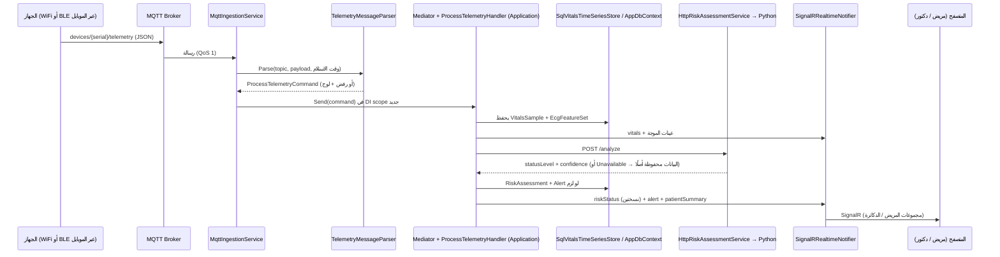

# تقرير تسليم الباك إند — CardioSense (الربع التالت: طبقة Infrastructure)
**تاريخ:** 31 أكتوبر 2026
**الغرض من الملف ده:** إن أي حد يقراه يفهم طبقة الـ Infrastructure اللي اتبنت كأنه هو اللي كاتب الكود: كل فولدر بيعمل إيه، كل ملف جواه إيه وشغلته إيه، وإزاي بتتكلم مع الـ Domain والـ Application اللي اتسلّموا قبل كده، وإيه اللي لازم يتأكد منه بـ `dotnet build` حقيقي.

---

## 1. ملخص سريع

- اتبنت **طبقة Infrastructure كاملة** = المشروع التالت من 4 مشاريع (الربع التالت من الباك).
- الأرقام: **36 ملف C# (≈ 2,074 سطر)** + ملف `csproj`. الحل كله دلوقتي (Domain + Application + Infrastructure) = **164 ملف C# (≈ 7,523 سطر)**.
- **ماتغيّرش ولا سطر في Domain ولا Application.** الإضافات الوحيدة برّه الـ Infrastructure: 5 إصدارات حزم في `Directory.Packages.props`، وإضافة المشروع للـ `CardioSense.sln`، وتحديث `README.md`.
- الـ Infrastructure بتنفّذ **كل** العقود (interfaces) اللي الـ Application والـ Domain كانوا مستنيينها: `IAppDbContext` و `IVitalsTimeSeriesStore` و `IIdentityService` و `ITokenService` و `IRiskAssessmentService` و `IRealtimeNotifier`، وبتضيف الـ MQTT worker اللي بيغذّي `ProcessTelemetry` / `ProcessDeviceStatus`.
- اللي لسه ⏳ (الربع الرابع): `Api` (Program.cs + الـ endpoints + الـ middleware) + `tests` + `cardiosense-ai` (Python) + `docker-compose.yml`.
- **مهم وصريح:** مفيش .NET SDK ولا إنترنت في الـ sandbox، فـ**ماعملتش `dotnet build`**، و**أول migration ماتولّدتش** (محتاجة `dotnet ef`). التفاصيل والأوامر في §2 و§11. أول حاجة تعملها: `dotnet build`.

## 2. التحقق والاختبار — بصراحة

### 2.1 اللي اتعمل فعلاً
1. **وسّعت أداة الفحص الثابت** (`back-verification-toolkit`) لتشمل Infrastructure: اتضاف المشروع، وقواعد الطبقات بقت لكل مشروع (Domain مايشوفش Application/Infrastructure/Api، Application مايشوفش Infrastructure/Api، Infrastructure مايشوفش Api)، واتضافت أسماء أنواع المكتبات الخارجية (32 namespace · 99 اسم: EF, Identity, SignalR, MQTTnet, JWT, System.Text.Json...) عشان نكشف الـ `using` الناقص والزايد، واتضاف فحص **أي سطر أطول من 120 حرف**.
2. **النتيجة على الحل كله: 164 ملف · 22 طلب = 22 handler · 15 validator · 0 مشاكل.** وفاحص المتغيرات (`ident_check.py`) رجّع 0 typo.
3. الفحص لقى مشاكل حقيقية واتصلحت قبل التسليم: ترتيب `using` في `MqttIngestionService`، و8 أسطر أطول من 120 حرف، واتعلّمت الأداة إن `_` (discard) و`var x` جوه الـ patterns تعريفات صحيحة (كانوا false positives).
4. **مراجعة يدوية للتوقيعات:** رجعت للكود الحقيقي (من الـ zip اللي بعتّه) وطابقت كل اسم الـ Infrastructure بتستخدمه: ثوابت الأطوال في الكيانات، والـ constructors الخاصة اللي EF محتاجها، وتوقيعات الـ 6 interfaces، وأشكال الـ records (`AccessTokenRequest`, `RiskAssessmentResult`, `ProcessTelemetryCommand`, `RiskStatusBroadcast`...)، و`Result` / `Error`. كله مطابق.

### 2.2 اللي **مش** متأكد منه (محتاج `dotnet build` حقيقي)
| # | البند | لو وقع إيه اللي تعمله |
|---|---|---|
| 1 | **API مكتبة MQTTnet v5**: `MqttClientFactory`، `ConvertPayloadToString()`، `WithTlsOptions(tls => tls.UseTls())`، `WithTopicFilter(topic, qos)`، `DisconnectAsync()` من غير باراميترات، والـ namespaces (`MQTTnet` و`MQTTnet.Protocol`). كتبتها من معرفتي بالمكتبة. | المكتبة مستخدمة في **ملف واحد بس**: `Ingestion/MqttIngestionService.cs`. أي خطأ بناء هيبقى فيه. (لو v4: `MqttFactory` بدل `MqttClientFactory`.) |
| 2 | **أرقام إصدارات NuGet** (`Directory.Packages.props`): EF Core/Identity `10.0.0`، `Microsoft.IdentityModel.JsonWebTokens 8.14.0`، `MQTTnet 5.0.1.1416`. | لو `restore` اشتكى غيّر الرقم. ولما الـ Api يضيف `JwtBearer` ممكن يطلع تحذير/خطأ `NU1605` (downgrade) → ارفع رقم IdentityModel لنفس اللي JwtBearer بيجيبه. |
| 3 | **استعلامات EF ماتجرّبتش على SQL Server حقيقي**، أهمها `GetHistoryAsync` (تجميع بـ `DATEDIFF(second)/bucket`) و`GetLatestForPatientsAsync` (group + join). | لو SQL Server اشتكى من الـ GROUP BY بالـ parameters، البديل: raw SQL لنفس الاستعلام جوه `SqlVitalsTimeSeriesStore` فقط (مفيش حد تاني بيتأثر). |
| 4 | `IdentityUserContext<ApplicationUser, Guid>` مع `AddIdentityCore().AddEntityFrameworkStores<AppDbContext>()`، والـ `HasIndex(expr, "اسم")` (فهرسين على نفس العمود). | مدعومين في EF/Identity الحديثين؛ لو اشتكوا الإصلاح في ملف واحد (`AppDbContext.cs` / `DoctorPatientAssignmentConfiguration.cs`). |
| 5 | **الـ hub جوه `JoinPatientGroup` بيعتمد على `IPatientAccessChecker` → `ICurrentUser`.** `ICurrentUser` هيتنفّذ في الـ Api من `HttpContext`؛ لازم نتأكد إنه بيشتغل جوه استدعاء الـ hub. | هيتختبر في ربع الـ Api (§8). |
| 6 | تحذيرات nullable / analyzers متوقعة (مش أخطاء؛ `TreatWarningsAsErrors` مقفول). | — |

## 3. شجرة الـ Infrastructure

```
src/CardioSense.Infrastructure/
├── CardioSense.Infrastructure.csproj         # مراجع: Application + Domain بس. + إطار ASP.NET Core (SignalR/Identity/Hosting)
├── DependencyInjection.cs                    # AddInfrastructure(): تسجيل كل حاجة بسطر واحد
├── Identity/
│   ├── ApplicationUser.cs                    # حساب الدخول (Identity + Role + PreferredLanguage + CreatedAt)
│   ├── IdentityErrors.cs                     # أخطاء الحساب + ترجمة أخطاء Identity لـ Error
│   ├── IdentityService.cs                    # تنفيذ IIdentityService فوق UserManager
│   ├── JwtClaimNames.cs                      # أسماء الـ claims (sub, role, patientId, doctorId) في مكان واحد
│   ├── JwtOptions.cs                         # إعدادات الـ JWT (issuer, audience, key, مدد الصلاحية)
│   └── JwtTokenService.cs                    # تنفيذ ITokenService: JWT access + refresh token + hash
├── Persistence/
│   ├── AppDbContext.cs                       # الـ DbContext (يطبّق IAppDbContext + جداول Identity + VitalsSamples)
│   ├── AppDbContextFactory.cs                # يخلّي أدوات dotnet ef تشتغل من غير الـ Api
│   ├── DatabaseInitializer.cs                # Migrate عند التشغيل + seed أجهزة تجريبية (Development)
│   ├── Configurations/                       # 13 كلاس mapping (واحد لكل جدول) + ملف helpers مشترك
│   │   ├── EntityConfigurationExtensions.cs  # ConfigureEntity / HasEnumAsString / HasRestrictedForeignKey
│   │   ├── ApplicationUserConfiguration.cs   # → Users
│   │   ├── PatientConfiguration.cs           # → Patients (+ sequence رقم الملف)
│   │   ├── DoctorConfiguration.cs            # → Doctors
│   │   ├── DeviceConfiguration.cs            # → Devices
│   │   ├── DoctorPatientAssignmentConfiguration.cs  # → DoctorPatientAssignments
│   │   ├── MedicalHistoryEntryConfiguration.cs      # → MedicalHistoryEntries
│   │   ├── VitalsSampleConfiguration.cs      # → VitalsSamples
│   │   ├── EcgFeatureSetConfiguration.cs     # → EcgFeatureSets
│   │   ├── RiskAssessmentConfiguration.cs    # → RiskAssessments (Flags كـ JSON)
│   │   ├── AlertConfiguration.cs             # → Alerts
│   │   ├── ElectrodeVerificationConfiguration.cs    # → ElectrodeVerifications
│   │   ├── RefreshTokenConfiguration.cs      # → RefreshTokens
│   │   └── AuditLogEntryConfiguration.cs     # → AuditLogs
│   └── Migrations/                           # فاضي (.gitkeep) — أول migration تتولّد بأمر واحد (§11)
├── TimeSeries/
│   └── SqlVitalsTimeSeriesStore.cs           # Phase 1: العلامات الحيوية في SQL Server
├── AiClient/
│   ├── AiServiceOptions.cs                   # عنوان خدمة الـ AI + timeout
│   ├── AiContracts.cs                        # شكل الـ JSON مع خدمة Python (العقد الفعلي)
│   ├── AiErrors.cs                           # Unavailable / InvalidAnswer
│   └── HttpRiskAssessmentService.cs          # تنفيذ IRiskAssessmentService (POST /analyze و /report)
├── Realtime/
│   ├── MonitoringNames.cs                    # أسماء الـ groups والـ events في مكان واحد
│   ├── MonitoringHub.cs                      # الـ SignalR hub (/hubs/monitoring)
│   └── SignalRRealtimeNotifier.cs            # تنفيذ IRealtimeNotifier
└── Ingestion/
    ├── MqttOptions.cs                        # إعدادات الـ broker
    ├── IngestionErrors.cs                    # أسباب رفض رسالة جهاز
    ├── TelemetryMessageParser.cs             # topic + JSON → Command (كود نقي بدون MQTT)
    └── MqttIngestionService.cs               # الـ BackgroundService اللي بيستقبل الرسائل
```

## 4. شرح كل فولدر

### 4.1 `Identity/` — الحسابات والتوكنز

| الملف | بيعمل إيه وليه |
|---|---|
| `ApplicationUser` | حساب الدخول: `IdentityUser<Guid>` + `Role` (Patient/Doctor) + `PreferredLanguage` + `CreatedAt`. الإيميل والباسورد hash والـ lockout بتاعة Identity نفسها. |
| `IdentityService` | تنفيذ `IIdentityService` فوق `UserManager`. **`CreateUserAsync`**: بيولّد Guid v7 للحساب ويدّيه لـ Identity. **`ValidateCredentialsAsync`**: إيميل غلط وباسورد غلط بيرجّعوا **نفس الخطأ** (`Auth.InvalidCredentials`)، ولو الإيميل مش موجود بيعمل hash وهمي بنفس تكلفة الفحص الحقيقي عشان **توقيت الرد مايكشفش** مين مسجّل. الحساب المقفول بيرجّع `Forbidden`، وكل محاولة فاشلة بتتعدّ (5 محاولات → قفل 15 دقيقة). **`FindByIdAsync`** و**`UpdatePreferredLanguageAsync`**: بسيطين. `UserManager` بيشتغل على نفس الـ `AppDbContext` بتاع الطلب، فإنشاء الحساب بيدخل في الـ transaction اللي `RegisterPatient`/`RegisterDoctor` فاتحينها. |
| `IdentityErrors` | الأخطاء الثابتة (`EmailTaken`=Conflict, `LockedOut`=Forbidden, `UserNotFound`=NotFound) + `From(...)` بتحوّل `IdentityError` لـ `Error`: إيميل مكرر → Conflict، أخطاء الباسورد → Validation على حقل `password`، إيميل بصيغة غلط → Validation على `email`، أي حاجة تانية → Failure. |
| `JwtTokenService` | **Singleton.** الـ access token = JWT موقّع HS256، عمره 15 دقيقة (قابل للتعديل)، فيه `sub` و`role` و(حسب الدور) `patientId` أو `doctorId`. الـ refresh token = **64 بايت عشوائي** (Base64Url) بيروح للـ cookie بس؛ والداتا بيز بتخزن **SHA-256 hash** منه (Base64، 44 حرف، ثابت فنقدر نلاقيه بالـ hash). |
| `JwtClaimNames` | أسماء الـ claims مكتوبة مرة واحدة: بيستخدمها كاتب التوكن والـ hub والـ `ICurrentUser` اللي في الـ Api — مفيش string مكرر يتنسى. |
| `JwtOptions` | `Jwt:Issuer/Audience/SigningKey/AccessTokenMinutes/RefreshTokenDays`. الـ `SigningKey` لازم ≥ 32 حرف، والتحقق بيحصل **وقت تشغيل التطبيق** (`ValidateOnStart`) فالغلطة بتوقّف التشغيل بدل ما تظهر في أول login. |

### 4.2 `Persistence/` — قاعدة البيانات

**`AppDbContext`** — كلاس `sealed` بيورّث `IdentityUserContext<ApplicationUser, Guid>` وبينفّذ `IAppDbContext`:
- 11 `DbSet` بنفس أسماء الـ interface، + `VitalsSamples` (**مش** في الـ interface عن قصد — الوصول ليه بس عن طريق `IVitalsTimeSeriesStore`).
- `BeginTransactionAsync` بيفتح transaction حقيقية (بتستخدمها handlers التسجيل). `SaveChangesAsync` من الأب.
- `OnModelCreating`: جداول Identity الأول (وبنسمّي `UserClaims`/`UserLogins`/`UserTokens` بنفس أسلوب باقي الجداول)، بعدين الـ **sequence** بتاع رقم ملف المريض، بعدين `ApplyConfigurationsFromAssembly` اللي بيلقط الـ 13 configuration لوحده.

**الـ Configurations (13 ملف)** — قرارات مشتركة (في `EntityConfigurationExtensions` مرة واحدة):
- **الجدول والمفتاح:** كل كيان له جدول بالاسم الجمع من التصميم (`Patients`, `DoctorPatientAssignments`...) والـ `Id` بيتولّد من الكيان (Guid v7) مش من الداتا بيز (`ValueGeneratedNever`).
- **الـ enums كنص** (`Stable`, `Critical`, `WiFi`...): مقروءة في SQL ومش بتتلخبط لو ترتيب الأعضاء اتغيّر. تأكدت إن كل ترتيب/تجميع بالخطورة في الـ Application بيحصل **في الذاكرة** (`GetMyPatientsHandler` و`PatientProfileAssembler`) مش في SQL، فالتخزين كنص مايكسرش ترتيب الخطورة.
- **كل الـ foreign keys = `Restrict` (مفيش cascade delete):** البيانات الطبية مينفعش تتمسح بصمت؛ المسح بيبقى عملية مقصودة (soft-delete/anonymization حسب قانون 151/2020 في الـ architecture doc).

| الجدول | أهم القرارات |
|---|---|
| `Users` | الدور كنص، اللغة، تاريخ الإنشاء. |
| `Patients` | `NationalId` و`FileNumber` و`UserId` كلهم **unique**. `FileNumber` بيتولّد من **sequence** (`NEXT VALUE FOR`) عند الـ insert فمستحيل مريضين يخدوا نفس الرقم. |
| `Doctors` | `LicenseNumber` و`UserId` unique. |
| `Devices` | `SerialNumber` unique. **فهرس unique مفلتر على `PatientId` (لما مش null)**: الداتا بيز نفسها بتمنع "جهازين لمريض واحد" حتى لو طلبين اتسابقوا بعد فحص الـ handler. |
| `DoctorPatientAssignments` | unique على `(DoctorId, PatientId)`، وفهرس عادي على `PatientId`، و**فهرس unique مفلتر (`IsPrimary = 1`)**: مريض واحد = دكتور primary واحد بالكتير (اللي زرار الاتصال بيرن عليه). |
| `MedicalHistoryEntries` | صف لكل تشخيص/دواء/حالة. |
| `VitalsSamples` | فهرس `(PatientId, Timestamp)` — ده الفهرس الوحيد المهم للجدول (قراءة "آخر قراءة" و"نافذة زمنية لمريض"). |
| `EcgFeatureSets` | نفس الفهرس. مفيش موجة خام. |
| `RiskAssessments` | `Flags` (قائمة) بتتخزن كـ JSON في عمود **`ContributingFactorsJson`** (زي التصميم) مع `ValueComparer` عشان EF يلاحظ التعديل جوه القائمة. علاقة **1-إلى-(0 أو 1)** مع `EcgFeatureSets` (unique على `EcgFeatureSetId`) زي الـ ER diagram. فهرس `(PatientId, Timestamp)`. |
| `Alerts` | فهرسين: `(PatientId, TriggeredAt)` للـ timeline، و`(PatientId, Severity, ResolvedAt)` لفحص "في Critical مفتوح؟" اللي بيحصل مع كل رسالة جهاز. |
| `ElectrodeVerifications` | فهرس `(PatientId, Timestamp)`. |
| `RefreshTokens` | `TokenHash` unique (كل تجديد بيدوّر بالـ hash). |
| `AuditLogs` | فهرس `(EntityType, EntityId, Timestamp)` = "مين شاف الملف ده ومتى". `UserId` اختياري (محاولات من غير تسجيل دخول بتتسجل برضه). |

**`AppDbContextFactory`** — بتخلّي أدوات `dotnet ef` تشتغل على مشروع الـ Infrastructure لوحده (من غير الـ Api). بتاخد الـ connection string من متغير بيئة `CARDIOSENSE_CONNECTION_STRING` (للأدوات بس، مش بتتستخدم وقت التشغيل).

**`DatabaseInitializer`** — بيستدعيه الـ `Program.cs` بتاع الـ Api: `MigrateAsync` (يطبّق الـ migrations) و`SeedDemoDevicesAsync` (Development بس: بيسجّل 10 أجهزة `CS-DEMO-0001...` في المخزون لو مفيش أجهزة، لأن الربط شغال على أجهزة موجودة في المخزون فقط ومفيش admin في Phase 1 — قرار #1 في تقرير الربع الأول).

### 4.3 `TimeSeries/SqlVitalsTimeSeriesStore.cs` — Phase 1 للـ time-series

بينفّذ الـ 6 methods بتاعة `IVitalsTimeSeriesStore`. كل التجميع **جوه الداتا بيز**:
- `GetLatestAsync`: أحدث صف لمريض.
- `GetLatestForPatientsAsync`: أحدث صف لكل مريض من قائمة، باستعلام واحد (group + join) — لقائمة مرضى الدكتور.
- `GetHistoryAsync`: **نقطة حقيقية (الأحدث) لكل bucket** في استعلامين خفيفين: (1) الداتا بيز بتجمّع بـ `DATEDIFF(second)/bucket` وبترجّع أحدث timestamp لكل bucket (بالكتير بضع مئات)، (2) بنجيب الصفوف دي بس. فرسم 30 يوم مايحمّلش عشرات الآلاف من الصفوف، ومفيش رقم مؤلّف.
- `GetHeartRateRangesAsync` (min/max لكل مريض) و`GetAverageHeartRateAsync`: بيتحسبوا في SQL.
- **`AppendAsync` بيحفظ فورًا** (بيعمل `SaveChanges`)، مش بيكتفي بـ `Add`. السبب: العقد لازم يبقى صحيح كمان لـ Influx في Phase 2 (الكتابة فورية)، ولو حد نسي `SaveChanges` بعده مايضيعش بيانات بصمت.
- لما Phase 2 ييجي: كلاس جديد `InfluxVitalsTimeSeriesStore` + تغيير سطر واحد في `DependencyInjection.cs`.

### 4.4 `AiClient/` — الاتصال بخدمة Python

- `HttpRiskAssessmentService` (typed `HttpClient`): `AssessAsync` → `POST /analyze`، و`GenerateReportNarrativeAsync` → `POST /report`.
- **أي مشكلة = `Error.Unavailable` (503)**: السيرفر مش واصل، timeout (الافتراضي 10 ثواني)، status مش نجاح، body مش JSON، أو الرد ناقص. الـ caller هو اللي بيقرر (الـ telemetry handler بيحتفظ بالبيانات، والـ report endpoint بيرجّع الفشل) — **مفيش تقرير بيتألف أبدًا.**
- **قاعدة أمان:** حقول الرد اللي لازم تكون موجودة (`statusLevel`, `confidenceScore`, `modelVersion`) **nullable** في الـ DTO، فلو الـ AI نسي `statusLevel` الرد بيترفض بدل ما يتحوّل بصمت لـ `Stable` (القيمة الافتراضية 0) — وده كان هيبقى false reassurance.
- الـ enums بتتقرا كأسماء بس (مفيش أرقام)، وقيمة مجهولة = رد مرفوض.
- العقد الفعلي (§7) مكتوب في `AiContracts.cs` — **ده اللي خدمة `cardiosense-ai` لازم تنفّذه.**

### 4.5 `Realtime/` — الدفع الفوري للمتصفحات

- **`MonitoringNames`**: أسماء الـ groups والـ events في مكان واحد. لكل مريض **جمهورين**: `patient-{id}` (اتصالات المريض نفسه) و`patient-{id}-doctors` (الدكاترة اللي فاتحين صفحة المريض ده دلوقتي)، ولكل دكتور `doctor-{id}` (لملخصات القائمة). الـ events: `vitals:{id}` و`ecg:{id}` و`riskStatus:{id}` و`alert:{id}` و`patientSummary:{doctorId}` — زي ما الفرونت مستنيها.
- **`MonitoringHub`** (`[Authorize]`): عند الاتصال المريض بيدخل group بتاعه والدكتور group بتاعه (من الـ claims). الدكتور بيستدعي `JoinPatientGroup(patientId)` لما يفتح صفحة مريض و`LeavePatientGroup` لما يسيبها (مش كل مرضاه مرة واحدة — 42 stream موجة على شاشة قائمة مش مفيدين). كل `Join` بيعدّي على **`IPatientAccessChecker`** — نفس المكان الوحيد اللي بيقرر "مين يشوف مين".
- **`SignalRRealtimeNotifier`** (Singleton): vitals و ecg و alert → للجمهورين. **`riskStatus` بنسختين:** النسخة الإكلينيكية (ثقة/سكور/flags) لمجموعة الدكاترة بس، ونسخة المريض (الحالة بس) للمريض بس — الـ Application هو اللي بيقرر المحتوى والـ notifier بيوزّع بس. الموجة: **رسالة لكل عينة** (الفرونت بتستقبل رقم واحد)، والإرسال بيقف عند أول فشل عشان اتصال ميّت مايطلعش مئات سطور لوج. أي فشل في الإرسال **بيتسجّل ومابيوقفش الـ pipeline** (best-effort).

### 4.6 `Ingestion/` — استقبال رسائل الأجهزة

- **`TelemetryMessageParser`** (كود نقي، مفيش MQTT فيه — سهل الاختبار): بياخد (topic, payload, وقت الاستلام) ويرجّع الـ command المناسب كـ `IRequest<Result>` (الاتنين بينفّذوه، فالـ worker مش محتاج `if` لكل نوع).
  - الـ **serial بيتاخد من الـ topic** (`devices/{serial}/telemetry|status`) مش من الـ JSON — جهاز مايقدرش يدّعي إنه جهاز تاني بتعديل الـ payload.
  - أي حقل مطلوب ناقص **بيتبلّغ عنه بالاسم** ومابيتحولش لـ 0 بصمت. لو الـ `timestamp` مش مبعوت، بيتستخدم وقت الاستلام.
  - الـ `features` (لو اتبعتت كـ object) بتتخزن كما هي في `FeatureVectorJson`.
- **`MqttIngestionService`** (`BackgroundService`): بيتوصل بالـ broker (TLS افتراضيًا، منفذ 8883) ويشترك في `devices/+/telemetry` و`devices/+/status` بـ QoS 1، وبيعيد الاتصال تلقائيًا كل 5 ثواني. كل رسالة → parse → `ISender.Send(...)` جوه **DI scope جديد**، يعني الـ validation والـ device check والـ pipeline كله بيشتغل زي أي طلب. رسالة بايظة/مرفوضة = لوج + drop (مفيش retry). أكتر من 1 ميجا = تتجاهل من غير ما تتقرا. `Mqtt:Enabled=false` بيقفله (للاختبارات).
  - **clean session**: لو الـ worker وقع، مفيش رسائل بتتخزن ليه — قراءات قديمة ملهاش لازمة.
- **ملحوظة سعة:** الرسائل بتتعالج **واحدة ورا التانية** (backpressure طبيعي). مع AI بطيء (حد أقصى 10 ثواني للرسالة) ممكن يحصل تراكم لو الأجهزة كتيرة. للـ Phase 1 (عشرات المرضى) كفاية؛ لو اتزنقنا: `Channel` + عدة workers، أو timeout أقل للـ AI.

### 4.7 `DependencyInjection.cs` — `AddInfrastructure(configuration)`

بيسجّل: الـ options (مع `ValidateOnStart`) · `AppDbContext` + `IAppDbContext` · Identity (باسورد ≥ 8 حروف **بدون** شروط تعقيد = نفس قاعدة الفرونت، إيميل unique، قفل بعد 5 محاولات) · `IIdentityService` · `ITokenService` · `IVitalsTimeSeriesStore` · `HttpClient` الـ AI (العنوان والـ timeout من الإعدادات) · SignalR (الـ enums كأسماء) · `IRealtimeNotifier` · `MqttIngestionService` · وبيربط `Monitoring:*` بـ`MonitoringOptions` بتاع الـ Application. **مفيش `EnableRetryOnFailure`** لأن handlers التسجيل بتفتح transactions صريحة وهي مش بتشتغل مع الـ execution strategy من غير لفّها.

## 5. رحلة رسالة جهاز واحدة (من الـ MQTT للمتصفح)



## 6. القرارات والتعديلات خارج الـ architecture doc

| # | البند | اللي في الـ doc | اللي اتعمل | السبب |
|---|---|---|---|---|
| 1 | مكان الـ hub | `Api/Hubs/MonitoringHub.cs` | **`Infrastructure/Realtime/MonitoringHub.cs`** (الـ Api بيعمل `MapHub` بس) | الـ notifier محتاج نوع الـ hub (`IHubContext<MonitoringHub>`)، ولو الـ hub في الـ Api يبقى الـ Infrastructure لازم تعمل reference على الـ Api = اعتماد دائري بيكسر قاعدة الاتجاه للداخل. |
| 2 | الـ DbContext | `IdentityDbContext<..., IdentityRole<Guid>, Guid>` | **`IdentityUserContext<ApplicationUser, Guid>`** | الدور عندنا عمود في `Users` (مش جداول Identity roles)، فـ`Roles`/`UserRoles`/`RoleClaims` كانوا هيبقوا 3 جداول فاضية للأبد. |
| 3 | أول migration | "أول migration" | **مش متولّدة** + `AppDbContextFactory` + أوامر جاهزة (§11) | الـ migration + الـ model snapshot لازم يتولّدوا بأداة `dotnet ef`؛ كتابتهم بإيدي بدون SDK خطر (snapshot غلط = EF بيرفض يشتغل). |
| 4 | قيود مفلترة في الداتا بيز | غير مذكورة | جهاز واحد لكل مريض + دكتور primary واحد لكل مريض (فهرسين unique مفلترين) | قواعد المنتج الموجودة في الـ handlers بقت مفروضة كمان من الداتا بيز ضد الـ race conditions. |
| 5 | `AppendAsync` | غير محدد | بيحفظ فورًا | §4.3. |
| 6 | الـ options | غير محدد | تحقق وقت التشغيل (`ValidateOnStart`) | مفتاح JWT ناقص/قصير يوقّف التطبيق فورًا برسالة واضحة. |
| 7 | JSON رسائل الأجهزة | **مش محدد في الـ docs** | عرّفته (§7) | `TelemetryMessageParser` محتاج شكل ثابت؛ **فريق الـ firmware لازم يطابقه.** |
| 8 | JSON خدمة الـ AI | الـ doc بيشرح `/analyze` بس | `/analyze` زي الـ doc (+ `riskScore` اختياري) و`/report` جديد (§7) | `/report` اتفقنا عليه في تقرير الربع الأول. |
| 9 | `Mqtt:Enabled` | غير مذكور | موجود (الافتراضي true) | اختبارات `WebApplicationFactory` وأجهزة من غير broker. |
| 10 | seeder الأجهزة | "seeder في Development" | `DatabaseInitializer.SeedDemoDevicesAsync` | §4.2. |
| 11 | توقيت فحص الدخول | غير مذكور | hash وهمي لو الإيميل مش موجود | منع كشف الإيميلات المسجّلة بقياس زمن الرد. |

## 7. العقود الخارجية اللي لازم الفريق التاني يطابقها

### 7.1 رسائل الجهاز (للـ firmware / تطبيق الموبايل)

`devices/{serialNumber}/telemetry` (الـ JSON بـ camelCase):
```json
{
  "timestamp": "2026-10-31T12:00:00Z",
  "heartRate": 74, "spo2": 98,
  "prIntervalMs": 152, "qrsDurationMs": 88, "qtMs": 396, "qtcMs": 418,
  "ecgSamples": [0.01, 0.02, 0.05],
  "features": { "any": "extra feature vector" }
}
```
المطلوبين: `heartRate, spo2, prIntervalMs, qrsDurationMs, qtMs, qtcMs`. الاختياريين: `timestamp` (لو مش موجود = وقت الاستلام)، `ecgSamples`، `features`. حدود القيم بيفرضها الـ validator في الـ Application (نبض 20–300، أكسجين 50–100، فواصل 1–2000 ms، مفيش وقت مستقبلي).

`devices/{serialNumber}/status`:
```json
{ "batteryLevel": 87, "connectionMode": "WiFi", "firmwareVersion": "1.2.0", "signalStrengthDbm": -61 }
```
المطلوبين: `batteryLevel` و`connectionMode` (`WiFi` أو `Bluetooth`). **الـ serial بييجي من الـ topic فقط.**

### 7.2 خدمة الـ AI (`cardiosense-ai`)

`POST /analyze`:
```json
// request
{ "patientId": "guid",
  "features": { "prIntervalMs": 152, "qrsDurationMs": 88, "qtQtcMs": [396, 418], "heartRate": 74, "spo2": 98 },
  "patientContext": { "age": 58, "priorDiagnosis": ["Prior MI", "Hypertension"] } }
// response  (statusLevel + confidenceScore + modelVersion إجباريين)
{ "statusLevel": "Stable", "confidenceScore": 0.94, "modelVersion": "v0.3-prototype", "riskScore": 18, "flags": [] }
```
`POST /report`:
```json
// request
{ "period": "daily",
  "patientContext": { "age": 58, "priorDiagnosis": ["Prior MI"] },
  "statistics": { "averageHeartRate": 74.2, "highestRiskScore": 31, "alertsLoggedCount": 2 } }
// response
{ "narrativeSummary": "..." }
```
`statusLevel` لازم يبقى `"Stable" | "Caution" | "Critical"` كنص؛ أي حاجة تانية = الرد بيترفض.

## 8. المطلوب من ربع الـ Api (عشان الطبقتين يتوصلوا صح)

1. `services.AddApplication(); services.AddInfrastructure(configuration);` (الأول Application لأنه بيسجّل `TimeProvider` اللي الـ Infrastructure محتاجاه).
2. **JwtBearer:** `MapInboundClaims = false` و`NameClaimType = "sub"` و`RoleClaimType = "role"` (الـ hub والـ `ICurrentUser` بيقروا الـ claims بأسمائها الخام من `JwtClaimNames`)، وقراءة الـ token من `access_token` في الـ query string لمسار `/hubs/monitoring` (WebSocket مابيبعتش Authorization header).
3. `app.MapHub<MonitoringHub>("/hubs/monitoring")`، و`AddHttpContextAccessor()`.
4. **`ICurrentUser` لازم يتختبر جوه استدعاء الـ hub** (`JoinPatientGroup`)؛ لو `HttpContext` طلع null هناك، نعدّل التنفيذ يقرا الـ claims من مصدر تاني.
5. `JsonStringEnumConverter` (من غير naming policy) + camelCase للـ REST.
6. عند التشغيل: `DatabaseInitializer.MigrateAsync` ثم (في Development) `SeedDemoDevicesAsync`.
7. متغير بيئة `TZ=Africa/Cairo`، وإعدادات: `ConnectionStrings:DefaultConnection`, `Jwt:*`, `AiService:BaseUrl`, `Mqtt:*` (والأسرار في User Secrets).
8. الـ `PatientAccessHandler` في الـ Api يبقى adapter رفيع فوق `IPatientAccessChecker` (زي ما اتفقنا في الربع الأول).

## 9. ملاحظة على النص الأول (ملقتهاش قبل كده — محتاجة قرارك)

في `ProcessTelemetryHandler` (سطر 163) رسالة الـ `Alert` بتتبني كالتالي: `"... Flags: possible_st_elevation."` — يعني **الـ flags (اللي المفروض doctor-only حسب الـ architecture doc §10) بتتحط جوه `Alert.Message`**، و`AlertMappings` بيمرّر الـ Message زي ما هي، فالمريض بيشوفها في `GET /patients/me/alerts` وفي الـ push (`alert:{id}`). ده بيناقض قاعدة "المريض يشوف حالة مش تفاصيل إكلينيكية".
**ماعدّلتش حاجة** (قرار تصميم في النص الأول). الحل الأبسط: أشيل الـ flags من نص الرسالة (الدكتور بيشوفها أصلًا في `riskStatus` النسخة الإكلينيكية). قولّي لو عايزني أطبّقه.

## 10. قرارات محتاجة منك

1. **الـ hub في Infrastructure بدل Api** (§6 بند 1) — موافق؟
2. **شكل JSON رسائل الجهاز** (§7.1) — ده اللي هيلتزم بيه الـ firmware (خصوصًا إن `qtMs` و`qtcMs` منفصلين، والوحدات بالـ ms). لو فريق الهاردوير عنده شكل تاني نعدّل الـ parser بس.
3. **ملاحظة الـ flags في §9** — أصلّحها؟
4. **`IdentityUserContext` بدل `IdentityDbContext`** (§6 بند 2) — مفيش مشكلة عندك لو جداول الـ roles مش موجودة؟

## 11. إزاي تبني وتولّد أول migration

```bash
cd back/cardiosense-backend
dotnet restore
dotnet build CardioSense.sln          # .NET 10 SDK — لو وقع: راجع §2.2 (MQTTnet / أرقام الحزم)

# أول migration (مرة واحدة، على جهاز عليه SDK و SQL Server):
export CARDIOSENSE_CONNECTION_STRING="Server=...;Database=CardioSense;..."   # للأدوات بس
dotnet tool install --global dotnet-ef
dotnet ef migrations add InitialCreate --project src/CardioSense.Infrastructure --output-dir Persistence/Migrations
dotnet ef database update --project src/CardioSense.Infrastructure
```
وبعد ما تتولّد، **افتح `Persistence/Migrations/*InitialCreate.cs` وراجع** إن فيه: الـ sequence `PatientFileNumbers`، والفهارس الـ unique المفلترة (`Devices.PatientId`، `OnePrimaryPerPatient`)، وعمود `ContributingFactorsJson`، وإن كل `onDelete` = `Restrict`.

لإعادة الفحص الثابت: `python3 check_backend.py <مسار cardiosense-backend>` (الأداة المحدّثة في `back-verification-toolkit.zip`).

## 12. الخطوات الجاية (الربع الرابع — مستني تعليماتك)

1. **Api:** `Program.cs` + الـ 22 endpoint (§5.3 من تقرير الربع الأول) + `Result → ProblemDetails` + `CurrentUser` + `PatientAccessHandler` (adapter) + `AuditLoggingMiddleware` + CORS مع credentials + rate-limit على login + cookie الـ refresh.
2. **tests:** unit tests للـ Domain/Application (وتغطية `TelemetryMessageParser` و`HttpRiskAssessmentService` لأنهم أنضف حاجات للاختبار) + integration tests على الـ authorization (`WebApplicationFactory` + SQL Server container).
3. **cardiosense-ai:** FastAPI بـ `/analyze` و`/report` حسب §7.2.
4. **docker-compose.yml:** api + sqlserver + redis + mosquitto (TLS) + ai.

---

## الملفات المسلّمة
- `CardioSense-Backend.zip` — فولدر `back/` كامل (Domain + Application + Infrastructure + التقارير + README).
- `INFRASTRUCTURE_REPORT.md` — التقرير ده (موجود جوه الـ zip كمان).
- `back-verification-toolkit.zip` — أدوات الفحص الثابت المحدّثة (بتغطي Infrastructure).
