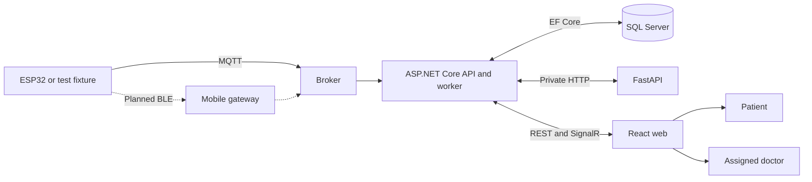

# Architecture overview and shared contract

PulseForge is the wearable research project. CardioSense is its web and backend platform. [Blueprint](blueprint.md) defines P01–P05 and F01–F05.

## Wire conventions and ownership

Use Guid account, profile and device IDs. Device serial identifies the MQTT topic. JSON uses camelCase, enum names and ISO 8601 timestamps in UTC. HR is BPM, SpO₂ is percent and ECG intervals are milliseconds. The frontend assumes a 250 Hz ECG rendering window. Confirm sampling and calibration with the hardware. JWT contains `sub`, `role` and the appropriate profile ID. SQL assignments determine doctor access. ProblemDetails carries HTTP errors and field errors for validation. Expect 401 for session, 403 for denied access, 404 for missing or concealed resources, 409 for conflicts and 429 for auth rate limits.

## REST and operational endpoints

| ID | Method and path | Caller and input | Output |
|---|---|---|---|
| API-01 | POST /api/auth/signup/patient | Visitor, name, phone, email, password, age, gender, nationalId, diagnosis, language and optional details | AuthResponse and refresh cookie |
| API-02 | POST /api/auth/signup/doctor | Visitor, identity and contact fields, specialty, licenseNumber, hospital, language and optional department | AuthResponse and refresh cookie |
| API-03 | POST /api/auth/login | Visitor, email and password | AuthResponse and refresh cookie |
| API-04 | POST /api/auth/refresh | Refresh cookie | accessToken and rotated cookie |
| API-05 | POST /api/auth/logout | Cookie when present | 204 and cookie cleared |
| API-06 | GET /api/patients/me | Patient | PatientProfile |
| API-07 | PUT /api/patients/me | Patient, editable profile fields | PatientProfile |
| API-08 | GET /api/patients/me/vitals-history | Patient, range | VitalsSample[] |
| API-09 | GET /api/patients/me/alerts | Patient | Alert[] |
| API-10 | GET /api/patients/me/ai-report | Patient, period | AiReport with null highestRiskReading |
| API-11 | GET /api/patients/{id} | Assigned doctor | PatientProfile |
| API-12 | GET /api/patients/{id}/vitals-history | Assigned doctor, range | VitalsSample[] |
| API-13 | GET /api/patients/{id}/alerts | Assigned doctor | Alert[] |
| API-14 | GET /api/patients/{id}/ai-report | Assigned doctor, period | AiReport with score when available |
| API-15 | POST /api/patients/{id}/manual-events | Assigned doctor, note and severity | 201 and recorded alert |
| API-16 | POST /api/patients/{id}/freeze-waveform | Assigned doctor, frozen boolean | 204 and audited action |
| API-17 | POST /api/patients/{id}/alerts/{alertId}/resolve | Assigned doctor, optional resolutionNote | Updated alert state |
| API-18 | GET /api/doctors/me | Doctor | DoctorProfile |
| API-19 | PUT /api/doctors/me | Doctor, editable profile fields | DoctorProfile |
| API-20 | POST /api/doctors/me/patients | Doctor, identifier | Assignment |
| API-21 | GET /api/doctors/me/patients | Doctor, status, search, page | PagedResult of PatientListItem |
| API-22 | GET /api/doctors/me/ward-stats | Doctor | WardStats |
| API-23 | POST /api/devices/pair | Patient, serialNumber | DeviceStatusResponse |
| API-24 | GET /api/devices/{serial}/status | Authorized device viewer | DeviceStatusResponse |
| OPS-01 | GET /health/live | Runtime health check | Process health |
| OPS-02 | GET /health/ready | Runtime health check | SQL readiness |
| OPS-03 | GET /openapi/v1.json | Development | OpenAPI schema |
| RT-01 | /hubs/monitoring | JWT | SignalR negotiation and connection |

Range values are `24h`, `7d`, `30d`. Report periods are `daily`, `weekly`, `monthly`. List filters are `all`, `stable`, `alert`, `critical`. Pagination exposes items, page, pageSize, totalCount and totalPages. Exact field declarations are in the [web contract](https://github.com/zeadhelal579-ux/pulseforge/blob/front-end/src/shared/types/api.ts), [server DTOs](https://github.com/zeadhelal579-ux/pulseforge/tree/back-end/cardiosense-backend/src/CardioSense.Application/Common/Dtos) and [endpoint handlers](https://github.com/zeadhelal579-ux/pulseforge/tree/back-end/cardiosense-backend/src/CardioSense.Api/Endpoints).

## Live events

| Event | Payload | Audience |
|---|---|---|
| vitals:{patientId} | patientId, heartRate, spo2, timestamp | Patient and authorized watching doctors |
| ecg:{patientId} | Single numeric sample | Same viewers |
| riskStatus:{patientId} | statusLevel, patientId and timestamp, plus clinical fields for doctors | Separate patient and doctor groups |
| alert:{patientId} | AlertDto | Authorized viewers |
| patientSummary:{doctorId} | PatientSummaryUpdate | Doctor personal group |

A patient joins their own group on connection. Doctors invoke `JoinPatientGroup` and `LeavePatientGroup` around an authorized detail view. REST restores stored history. SignalR delivers best-effort live data. Status values are Stable, Caution and Critical. Clinical score is a 0–100 heuristic.

See [AI](ai-architecture.md) for HTTP inference, [IoT](iot-device-architecture.md) for topics, and [Infrastructure](infrastructure-deployment.md) for environment settings.
