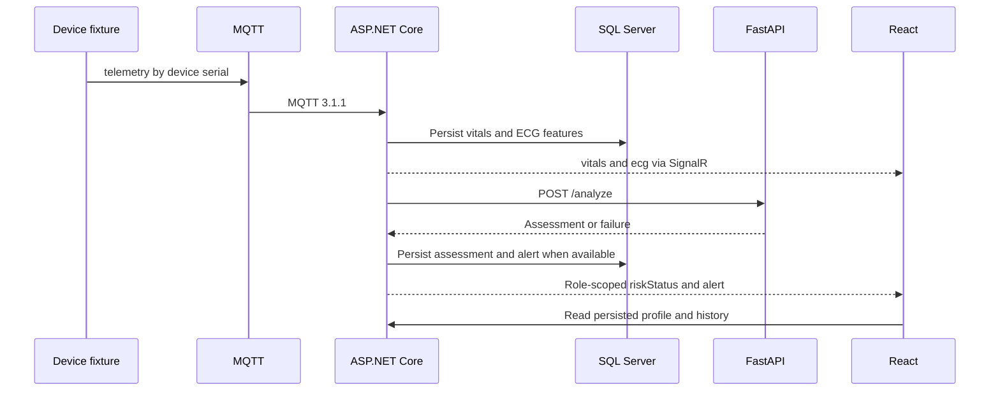

# User journeys and data flows

## F01 Session

P01 submits API-01, API-02 or API-03. The backend issues an access token and an HTTP-only refresh cookie. The browser stores the access token in memory and routes by role. On reload, API-04 renews the session before the profile fetch. One shared refresh promise handles concurrent business-request 401 responses. API-05 revokes refresh state and the client clears cached account data.

## F02 Ownership and pairing

The patient enters a device serial in P05. API-23 checks inventory and ownership, writes the relation and updates the profile. A doctor enters the patient identifier in P03. API-20 creates an assignment and refreshes the list. The API checks the assignment on detail access and SignalR joins. Production needs verified clinician enrollment and a consent workflow.

## F03 and F04 Live readings and alerts

The patient joins their own group when connecting. The doctor joins the open patient file and rejoins after reconnect. ECG leaves Live after 15 seconds without samples. Vitals can remain visible as the last measurement. A pilot needs explicit age and source indicators. A failed AI call leaves the measurement available without a new assessment. Critical stays latched until doctor resolution. Caution can raise Moderate on transition, and Stable can resolve open non-critical risk alerts.

## F05 Report and doctor actions

The browser requests a daily, weekly or monthly report. The backend computes period aggregates and supplies permitted data to FastAPI. Patients receive a status-oriented narrative and a null highest-risk score. An assigned doctor can view the numeric value, freeze the browser waveform and record a manual event. The API supports resolving alerts. A dedicated resolve UI remains a gap.
