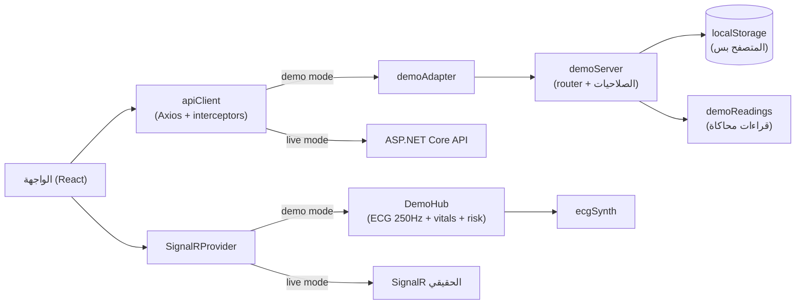

# تقرير: وضع الـ Demo + تجهيز الفرونت للرفع على Vercel
**تاريخ:** 22 أكتوبر 2026
**الغرض من الملف ده:** شرح كامل لكل حاجة اتعملت في الشات ده: إيه اللي اتراجع، إيه اللي لقيناه واتصلح، وضع الـ Demo شغال إزاي (ملف ملف)، إزاي ترفع على Vercel، وإيه اللي اتحقق منه وإيه اللي لسه محتاج تتحقق منه بنفسك.

---

## 0. ملخص سريع

| اللي طلبته | اللي اتعمل |
|---|---|
| راجع كل ملفات المشروع | اتراجعت الـ 7 مستندات (معماريتين، `PROJECT_OVERVIEW`، `HANDOFF_DOC`، `HANDOFF_REPORT`، `TESTING_REPORT`، `BACKEND_REPORT`) وكل ملفات الفرونت (110 ملف) |
| عدّل الفرونت عشان يبقى جاهز لـ Vercel | `vercel.json` (SPA rewrite + headers)، `build` بقى `vite build`، إعداد TypeScript اتصلّح، Node 22، تقسيم الصفحات (lazy routes)، `.env.example` واضح، `index.html` اتظبط |
| صفحة اللوجن زي الصورة: كليك على حساب يملّي البيانات ويدخلني | قائمة **Demo accounts** تحت فورم الدخول: كليك على أي حساب → الإيميل والباسورد بيتملوا قدامك → بتدخل فورًا. 4 حسابات: دكتور + 3 مرضى (مستقر / تنبيه / حرج) |
| "Data is stored in this browser only" + "Reset demo data" | موجودين: البيانات كلها في `localStorage`، ولينك **Reset demo data** في صفحة اللوجن وفي الشريط الأصفر فوق كل الصفحات |
| ملف `.gitignore` كويس | `.gitignore` شامل + `.gitattributes` (LF) + `.nvmrc` |
| مضغوط كامل + ريبورت | `CardioSense-Frontend-vercel.zip` + الملف ده |

**أهم فكرة:** عشان صفحة اللوجن تدخّلك من غير باك إند، عملت **باك إند محاكي جوه المتصفح** (`src/shared/demo/`). هو بيرد على نفس الـ endpoints بنفس الأشكال ونفس قواعد الصلاحيات، وبيبعت ECG حي محاكى. بيتركّب على مستوى الـ transport بس، فباقي كود الفرونت (والـ interceptors) بيشتغل زي ما هو. وأول ما تحط `VITE_API_BASE_URL` الفرونت بيرجع يكلّم الباك الحقيقي من غير ما تغيّر سطر كود.

---

## 1. الصورة المرجعية

الصورة اللي بعتّها من مشروع تاني (**PharmacyERP**): كارت أبيض فيه لوجو + عنوان "Sign In" + حقلين (Email / Password) + زرار أزرق "Sign In"، وتحتيه خط متقطع وقسم **"Demo accounts (click to fill)"**: 4 صفوف (اسم الدور على الشمال والإيميل على اليمين) بتملّى الفورم وتدخّل لما تدوس عليها، وفي الآخر "Data is stored in this browser only. **Reset demo data**".

اللي أخدته من الصورة: **الوظيفة والترتيب** (قائمة حسابات + كليك = ملي + دخول + Reset). اللي ما نقلتوش: الألوان الزرقاء والخطوط، لأن CardioSense ليه هويته (كحلي + تركواز). القائمة اتصممت بنفس الـ design tokens والمكونات الموجودة، وبتشتغل صح في العربي (RTL) والإنجليزي، ونهار وليل.

---

## 2. مراجعة الفرونت: إيه اللي لقيناه

### 2.1 مشاكل اتصلحت

| # | الخطورة | المشكلة | الحل |
|---|---|---|---|
| 1 | عالية (Vercel) | `build` كان `tsc -b && vite build`. (أ) أي type error ضد الـ types الحقيقية للمكتبات هيوقف الـ deploy، والمشروع عمره ما اتبنى ببيئة فيها إنترنت. (ب) `tsc -b` كان بيبني `tsconfig.node.json` (`composite`) فبيطلّع `vite.config.js` و `.d.ts` جنب الـ `.ts`. **جربتها فعليًا**: Vite بيحمّل الـ `.js` قبل الـ `.ts`، فأي تعديل بعد كده في الـ `.ts` مش هيتقري. (ج) `tsc -b` بيفحص `vitest.config.ts` كمان وممكن يعمل تعارض types بين vite 6 و vitest 2 | `build` بقى `vite build` بس. الفحص اتنقل لـ `npm run typecheck` و `npm run build:check`. شلت `references` و `composite`، و `tsconfig.node.json` بقى `noEmit` |
| 2 | عالية (Vercel) | مفيش SPA fallback: أي refresh على `/doctor/patients` أو `/patient` كان هيدي 404 | `vercel.json` فيه rewrite لكل المسارات ما عدا `/assets/` (عشان ملف ناقص يدي 404 حقيقي مش صفحة HTML) |
| 3 | متوسطة | شريط الدكتور الجانبي كان فيه "Connection Status: **Stable**" ثابت في الكود، يعني هيفضل مكتوب Stable حتى لو الـ WebSocket مقطوع. ده بيخالف مبدأ المشروع "ماتطمّنش بالغلط" | بقى بيعرض الحالة الحقيقية للاتصال (متصل / جاري الاتصال / جاري إعادة الاتصال / غير متصل) بألوانها |
| 4 | متوسطة | كارت **AI Report** كان بيعرض الرقم الخام "highest risk reading X/100" للمريض كمان، وده بيخالف قاعدة "المريض يشوف حالة مش رقم" (`PROJECT_OVERVIEW` §4). الباك بيرجّعه فعلًا (اتذكر في `BACKEND_REPORT` §11.2) | الكارت بقى بياخد `showRiskScore`؛ شاشة المريض بتخفيه (وبيتشال من صورة التقرير المصدّرة كمان)، والدكتور بيشوفه |
| 5 | متوسطة | كارت الأقطاب كان بيكتب "اتصال الأقطاب مؤمّن بالكامل" حتى لو الحالة **Reposition Needed** | لو الحالة محتاجة إعادة وضع بيظهر تحذير (أيقونة وألوان تحذير + نص "راجع مكان الأقطاب") بدل الطمأنة |
| 6 | منخفضة | `CardioSense OS v4.2.8` رقم إصدار متألف في السايدبار | اتبدّل بـ "نموذج بحثي أولي / Research prototype" |
| 7 | منخفضة | `vite-env.d.ts` كان معيد تعريف `DEV/PROD/MODE` بـ `readonly` (تعارض modifiers مع `vite/client`، مستخبّي بسبب `skipLibCheck`) ومتغيرات البيئة معرّفة إجبارية وهي اختيارية | اتنضف: متغيرات اختيارية فقط + `VITE_DEMO_MODE` |
| 8 | منخفضة | `baseUrl` في `tsconfig` deprecated في TypeScript 6 (وبيتشال في 7) | اتشال، والـ `paths` بقت `./src/*` (جربت: TS 6 بيدي error عليه فعلًا) |
| 9 | منخفضة | Recharts 2 مع React 19 معروف إنه محتاج `react-is` على نفس إصدار React، وإلا الرسومات ممكن تطلع فاضية | ضفت `overrides: { "react-is": "^19.0.0" }` احتياطي (مش بيضر لو مش لازم) |
| 10 | منخفضة | كل الصفحات والـ Recharts بتتحمل مرة واحدة حتى في صفحة اللوجن | route-level lazy loading: اللوجن بيتحمل لوحده، والداشبوردات بعد الدخول |
| 11 | منخفضة | `.gitignore` بسيط وناقص (مفيش `.vercel` ولا `.env.*` ولا `*.zip`...)، ومفيش `.gitattributes` / `.nvmrc`، و `.env.example` مش بيشرح الأوضاع | اتعملوا (قسم 6) |
| 12 | منخفضة | `index.html`: مفيش preconnect لـ `fonts.gstatic.com`، ومفيش `noindex` لنموذج بحثي | اتضافوا |
| 13 | منخفضة | صفحة الدخول كانت بتفتح على تاب **Sign up** | في وضع الـ demo بتفتح على **Sign in** (حيث قائمة الحسابات) |

### 2.2 ملاحظات اتسابت من غير تعديل (للعلم)

- ملفات الفرونت القديمة من غير الهيدر الإنجليزي (`File / Purpose / Logic`) اللي بقية مشاريعك عليه. **كل الملفات الجديدة عليها الهيدر وتعليق على كل دالة**. لو عاوز أضيفه للقديم قولّي.
- زراير الاتصال في صف المريض (قائمة الدكتور) من غير handler (الـ DTO مفيهوش رقم تليفون)، وزرار "Forgot password" من غير وظيفة، و "Reports" و "Notifications" معطّلين. دي ناقصة في الأصل ومش مرتبطة بالـ deploy.
- `msw` و `@testing-library/user-event` متعرّفين في `package.json` ومش مستخدمين (اتذكروا في `TESTING_REPORT`).
- `.eslintrc.cjs` بالـ legacy format: شغال مع ESLint 8 المثبّت، بس هيحتاج تحويل لو رقّيت لـ ESLint 9.
- مفيش `package-lock.json` (مقدرتش أعمله من غير إنترنت). **اعمله بأول `npm install` وارفعه مع الكود.**
- المستندات الأصلية كانت بتقول "مفيش بيانات وهمية على الموقع". الـ demo بيكسر القاعدة دي **عن قصد** وبتحذير واضح (قسم 3.5).

---

## 3. وضع الـ Demo

### 3.1 الفكرة



- **ليه على مستوى الـ adapter؟** لو بدلت ملفات الـ API (`authApi`, `patientApi`...) كنا هنفقد الـ interceptors (إضافة التوكن + 401 → refresh → retry) ونختبر كود مختلف عن الحقيقي. بالـ adapter كل ده بيشتغل فعلًا في الـ demo، وبيتجرّب نفس المسار اللي الباك الحقيقي هيمشي عليه. (الـ access token عمره 15 دقيقة فعلًا، فبعد 15 دقيقة هتشوف الـ refresh شغال لوحده.)
- **ليه الـ hub "مبني على الاشتراك"؟** ستريم المريض بيبدأ لما أول handler يتسجّل على `ecg:{id}` أو `vitals:{id}` أو `riskStatus:{id}` ويقف لما آخر واحد يتشال. ده بيغطي شاشة المريض (بتشترك لوحدها) وشاشة الدكتور (بعد `JoinPatientGroup`) من غير نمذجة groups.
- **الـ ECG بيتولّد بمعدل 250Hz بالظبط**: بيحسب كام عينة "استحقت" من الوقت اللي فات، فالمعدل بيفضل صح حتى لو المتصفح أخّر الـ timers.

### 3.2 امتى بيشتغل الـ demo؟ (`src/shared/lib/env.ts`)

| الإعداد | الوضع |
|---|---|
| مفيش أي متغير (الافتراضي، وده حال Vercel أول مرة) | **Demo** |
| `VITE_API_BASE_URL` متحدد | باك حقيقي |
| `VITE_DEMO_MODE=true` | Demo إجباري |
| `VITE_DEMO_MODE=false` | باك حقيقي إجباري |

القيم الفاضية (`VITE_API_BASE_URL=`) بتتعامل كأنها مش موجودة، عشان سطر فاضي في `.env` ماينقلبش لـ base URL فاضي.

### 3.3 الحسابات التجريبية

الباسورد لكل الحسابات: **`Demo@1234`** (معروض في الصفحة عن قصد، والبيانات خيالية).

| الإيميل | الدور | الحالة المحاكاة |
|---|---|---|
| `doctor@cardiosense.demo` | دكتور | Dr. Sara El-Mansour، 12 مريض في القائمة |
| `patient@cardiosense.demo` | مريض | **Stable**: Ahmed Mostafa Kamal، نبض ~74، SpO₂ ~98 |
| `patient.caution@cardiosense.demo` | مريض | **Caution**: Fatima Hassan Ibrahim، نبض غير منتظم + ضربات مبكرة |
| `patient.critical@cardiosense.demo` | مريض | **Critical**: Mahmoud Abdelrahman، نبض ~118، ST elevation، QRS عريض |

**العنبر (13 مريض مخلوقين بنفس الـ seed):**
- 12 مربوطين بالدكتور: 7 Stable + 3 Caution (واحد منهم *Technical alert*: جودة إشارة ضعيفة وأقطاب محتاجة تظبيط) + 2 Critical. ده بيدي إحصائيات حقيقية (12/50 نشط، جهاز واحد offline فـ 11/12 متصل).
- مريض واحد (Walid Samir Mansour، رقم قومي `29000000000099`) **مش مربوط بالدكتور** عشان تجرّب زرار **Add New Patient**. ولما تفتح الـ modal هتلاقي تلميح بالرقم ده.
- أرقام التليفونات (`0100000xxxx`) والأرقام القومية (`2900000000xxxx`) واضح إنها وهمية.

**حاجات تجرّبها:**
1. ادخل دكتور → افتح المريض الحرج → **Freeze Waveform** → **Log Manual Event** وشوف التنبيه ظهر عند المريض.
2. اعمل **Sign up** كمريض جديد: بيبدأ **من غير أي قراءات** (حالة "في انتظار البيانات") زي الحقيقي، وبعدين من **Settings** اربط جهاز بأي serial (مثلًا `CS-95001-EG`) وهتبدأ البيانات الحية.
3. بدّل اللغة (النصوص اللي بتيجي من "السيرفر" زي التنبيهات وملخص الـ AI بتتغيّر معاها) وبدّل نهار/ليل.

### 3.4 قواعد الباك الحقيقي اللي الـ demo بيطبّقها

- المريض يوصل لسجله هو بس (`/patients/me` أو id بتاعه)؛ الدكتور يوصل لمرضاه المربوطين بيه بس، غير كده **403**.
- الدكتور مالوش `/patients/me`، والمريض مالوش endpoints الدكتور.
- المريض **مبيستلمش** رقم الـ risk ولا الـ confidence ولا الـ flags: بتتشال من الرد ومن الـ push (مش بس مخفية في الـ UI).
- Manual event و Freeze Waveform للدكتور بس. الجهاز: مريض واحد ↔ جهاز واحد (409 لو متكرر).
- جهاز مش بتاعك بيرجّع **404** مش 403 (عشان محدش يخمّن serials). ونفس رسالة الخطأ لإيميل مش مسجّل وباسورد غلط.
- أخطاء بصيغة ProblemDetails (`title/status/detail/errors`) والـ validation بـ `errors` لكل حقل.

### 3.5 إيه الحقيقي وإيه المحاكى (أمانة)

| مُحاكى | ملاحظة |
|---|---|
| إشارة الـ ECG | مولّد رياضي (شكل P-QRS-T) مش بيانات جهاز. ومكتوب عليها علامة **"محاكاة"** جنب "Live" |
| النبض / SpO₂ / الـ risk | دوال حتمية من baseline المريض والوقت (نفس القيمة عبر REST والـ hub) |
| ملخص الـ AI | قوالب نصية من أرقام حقيقية للفترة، ومكتوب في آخره "(متولّد من بيانات تجريبية محاكاة)". ومبيفضحش للمريض أي تفاصيل خاصة بالدكتور |
| الـ auth | توكن بنفس شكل JWT بس **من غير توقيع حقيقي**. مفيش أمان فعلي، وده مقصود لأن كل حاجة في المتصفح |
| الباسوردات | الحسابات الجاهزة بتستخدم الباسورد العام. الحسابات الجديدة بتتخزّن **hash (SHA-256 + salt)** مش نص |

كمان فيه **شريط أصفر ثابت** فوق كل الصفحات: "وضع تجريبي: بيانات محاكاة ومتخزنة في متصفحك بس. متكتبش بيانات شخصية أو طبية حقيقية" + زرار Reset. ومفيش أي ادعاء "Clinically Validated".

### 3.6 فروقات مقصودة عن الباك الحقيقي

- Manual event بدرجة Critical **مبيقفلش** حالة المريض (الحقيقي بيقفلها لحد ما دكتور يحلها، ومفيش شاشة Resolve في الفرونت لسه).
- ربط الجهاز بيقبل أي serial سليم الشكل (الحقيقي بيرفض الـ serial اللي مش في المخزون).
- أسماء المرضى والتشخيصات إنجليزي (حقل واحد في الـ DTO). أما النصوص المولّدة (التنبيهات، حالة القائمة، ملخص الـ AI) فبتتوّلد بلغة الواجهة.
- مريض من غير قراءات: النبض والأكسجين `0` والحالة "Awaiting Data" (زي ما `BACKEND_REPORT` §11.2 وصفها).

---

## 4. الملفات الجديدة (ملف ملف)

كلها عليها هيدر إنجليزي (File / Layer / Purpose / Logic / Implementation) وتعليق على كل دالة. الاعتماد: `shared/demo/*` بيستورد من `shared` بس (مفيش `features` ولا `app`).

### 4.1 `src/shared/demo/` (3,405 سطر)

| الملف | بيعمل إيه |
|---|---|
| `demoConstants.ts` | كل الأرقام والمفاتيح في مكان واحد: مفتاح التخزين، الباسورد العام، الـ latency (140–360ms)، عمر التوكن (15 د) والـ session (7 أيام)، حجم الصفحة (5)، 250Hz، فترات الـ ticks |
| `demoMath.ts` | `hash01` / `valueNoise` / `createRng`: عشان كل "عشوائي" يبقى دالة في (seed, وقت)، فنفس اللحظة تدي نفس القراءة |
| `demoTypes.ts` | أشكال السجلات المخزنة (مريض، دكتور، جهاز، تعيين...) + ظرف الطلب/الرد. الـ DTOs العامة بتتعاد استخدامها من `shared/types/api.ts` عشان الـ demo ما يبعدش عن العقد |
| `demoAccounts.ts` | قائمة الحسابات التجريبية: **المصدر الوحيد** للقائمة اللي في اللوجن وللـ seed |
| `ecgSynth.ts` | مولّد ECG بالعينة: P/Q/R/S/T كـ Gaussians على **كسور من الـ RR** (نفس النسب اللي كاشف علامات الموجة في الفرونت بيفترضها، فحروف P/Q/R/S/T بتقع في مكانها الصح عند أي نبض). معاملات: ST elevation، عرض QRS، ضوضاء، عدم انتظام، ضربات مبكرة + pause تعويضي |
| `demoText.ts` | كل النصوص "اللي بتيجي من السيرفر" بالعربي والإنجليزي (labels القائمة، رسائل التنبيهات، ملخص الـ AI) + قراءة اللغة من `<html lang>` |
| `demoReadings.ts` | دوال خالصة: نبض/أكسجين (إيقاع يومي + noise)، risk، فواصل ECG، جودة الأقطاب، Timeline الـ 24 ساعة، history بـ 3 مدى (5د/ساعة/6 ساعات)، والجهاز الـ offline |
| `demoAuth.ts` | توكن بشكل JWT (نفس الـ claims: `sub`, `role`, `patientId`/`doctorId`, `iat`, `exp`)، hash الباسورد، `newId` |
| `demoStorage.ts` | القراءة/الكتابة في `localStorage` + Reset + إعادة seed لو الداتا فاسدة أو إصدارها قديم + fallback للذاكرة لو التخزين مقفول |
| `demoSeed.ts` | داتا البداية (دكتور + 13 مريض + أجهزة + 3 أجهزة فاضية للتجربة) |
| `demoModel.ts` | بيبني الـ DTOs بالشكل اللي الفرونت مستنيه (`PatientProfile`, `PatientListItem`, `WardStats`, `Alert[]`, `AiReport`...) ويطبّق قاعدة إخفاء أرقام الـ AI عن المريض |
| `demoServer.ts` | **الـ router**: 19 endpoint (auth ×5، patients ×7، doctors ×5، devices ×2) + الصلاحيات + الـ validation + ProblemDetails. بدون أي اعتماد على Axios عشان يتختبر بسهولة |
| `demoAdapter.ts` | Axios adapter رفيع: بيحوّل الـ config لطلب، بيستنى latency، وبيرجّع Response أو `AxiosError` (عشان الـ interceptors تشتغل). بيفهم الـ URL النسبي والـ URL الكامل بتاع الـ refresh |
| `demoHub.ts` | بديل `HubConnection`: `on/off/invoke/start/stop`... بيبعت ECG (250Hz) و `vitals:` كل ثانيتين و `riskStatus:` كل 10 ثواني. المريض بيستلم الحالة بس. الـ clock والـ scheduler قابلين للحقن عشان الاختبار |

### 4.2 ملفات جديدة تانية

| الملف | بيعمل إيه |
|---|---|
| `src/shared/lib/env.ts` | نقطة واحدة لقراءة متغيرات البيئة + قاعدة الـ demo (قسم 3.2) |
| `src/shared/components/DemoBanner.tsx` | الشريط الأصفر + Reset (بيرجع `null` لو مش demo) |
| `src/features/auth/components/DemoAccountsPanel.tsx` | قائمة الحسابات: كل صف فيه أيقونة الدور + (حالة المريض) + الإيميل. بتبلّغ `LoginForm` بالاختيار بس، و `LoginForm` هو اللي بيملّي ويدخّل، فمفيش مسار دخول تاني |
| `src/app/providers/DemoRuntime.tsx` | لما اللغة تتغير بيعمل refetch لـ 3 queries بس (`patient-alerts`, `ai-report`, `patients-list`) عشان النص المتولّد يتبدّل |
| `src/test/demoTestUtils.ts` | مساعدات الاختبار (استدعاء الـ router، دخول بحساب، تثبيت اللغة والوقت) |
| `vercel.json` / `.nvmrc` / `.gitattributes` | قسم 6 |
| `docs/DEMO_VERCEL_REPORT.md` + `docs/assets/demo-ecg-preview.png` | الملف ده + صورة تحقق من شكل الـ ECG المحاكي |

### 4.3 ملفات اختبار جديدة (74 اختبار)

`demoServer.test.ts` (auth + صلاحيات + قائمة الدكتور + إحصائيات + history + report + ربط الجهاز)، `demoAdapter.test.ts`، `demoHub.test.ts`، `ecgSynth.test.ts`، `demoReadings.test.ts`، `demoAuth.test.ts`، `demoStorage.test.ts`، و `ecgDemoSignal.test.ts` (بيتأكد إن علامات P/R/T بتقع على موجات حقيقية في الإشارة المحاكاة).

---

## 5. الملفات الموجودة اللي اتعدلت

| الملف | التعديل |
|---|---|
| `shared/lib/apiClient.ts` | بيقرأ `API_BASE_URL` من `env.ts`، وفي الـ demo بيركّب `demoAdapter` (على الـ instance وعلى نداء الـ refresh اللي بيستخدم `axios` مباشرة) |
| `shared/lib/signalrClient.ts` | في الـ demo بيرجّع `DemoHub` (مع cast واحد موثّق، لأن `HubConnection` فيه private members) |
| `app/providers/i18n.ts` | اللغة الافتراضية من `env.ts` |
| `app/App.tsx` | إضافة `DemoRuntime` جوه `QueryProvider` |
| `app/router.tsx` | lazy loading للصفحات الأربع + `Suspense` جوه الـ layout (الـ sidebar فاضل ظاهر وقت التحميل) |
| `app/layouts/AuthLayout.tsx` / `PatientLayout.tsx` | `DemoBanner` فوق |
| `app/layouts/DoctorLayout.tsx` | `DemoBanner` فوق كل حاجة (حتى في الموبايل لما السايدبار بيتحط فوق)، حالة الاتصال الحقيقية، شيل رقم الإصدار المتألف |
| `features/auth/components/LoginForm.tsx` | `handleDemoPick`: `setValue` للحقلين ثم `mutation.mutate` + سبينر على الصف المختار |
| `features/auth/pages/AuthPage.tsx` | افتح على Sign in في الـ demo |
| `features/doctor-dashboard/pages/PatientListPage.tsx` | تلميح الرقم القومي في Add Patient (demo بس) |
| `features/patient-dashboard/components/AiReportCard.tsx` + `PatientDetailContent.tsx` | `showRiskScore` (قسم 2.1 #4) |
| `features/patient-dashboard/components/ElectrodeStatusCard.tsx` | حالة "Reposition" (قسم 2.1 #5) |
| `features/patient-dashboard/components/EcgWaveform.tsx` | علامة "محاكاة" في الـ demo |
| `locales/en` و `locales/ar` | 15 مفتاح جديد في كل لغة (**227 مفتاح، تطابق 1:1**) |
| `vite-env.d.ts` / `tsconfig.json` / `tsconfig.node.json` | قسم 2.1 (#1, #7, #8) |
| `package.json` | scripts + `engines: 22.x` + `overrides: react-is`. **الـ dependencies نفسها من غير تغيير** |
| `index.html` / `.env.example` / `.gitignore` / `README.md` | قسم 6 |

---

## 6. Vercel

### 6.1 الملفات

| الملف | ليه |
|---|---|
| `vercel.json` | `framework: vite`، `npm run build`، `dist`، SPA rewrite (مع استثناء `/assets/`)، cache طويل للـ assets، headers أمان بسيطة (`nosniff`، `SAMEORIGIN`، `Referrer-Policy`) و `X-Robots-Tag: noindex` |
| `.gitignore` | `node_modules/`، `dist/`، **`.env` و `.env.*` ما عدا `.env.example`**، `.vercel`، logs، caches، ملفات المحررات وأنظمة التشغيل، **`*.zip`** (عشان الأرشيف ما يترفعش بالغلط). عمدًا **مش** بيتجاهل `package-lock.json` |
| `.gitattributes` | `eol=lf` عشان ويندوز و Vercel (Linux) يشوفوا نفس الملفات + علامات الملفات الـ binary |
| `.nvmrc` + `engines` | Node 22 (Vercel بيختار منها) |
| `.env.example` | بيشرح الأوضاع (demo / live) والمتغيرات، كلها متعلّقة بالـ comment |
| `index.html` | `noindex` + preconnect لـ `fonts.gstatic.com` + `<noscript>` |

> ملاحظة: Tailwind v4 بيتجاهل الملفات اللي في `.gitignore` وقت مسح الـ classes. راجعت إن مفيش نمط في الـ `.gitignore` بيطابق أي ملف في `src/`.

### 6.2 خطوات الرفع

1. فك الـ zip (فيه فولدر `CardioSense-Frontend/`) وادخله.
2. **`npm install`** (ده بيعمل `package-lock.json`: ارفعه مع الكود).
3. اتأكد محليًا: `npm run dev` وجرب اللوجن بالحسابات التجريبية.
4. Vercel: **Add New → Project → Import** الريبو. الإعدادات بتتقري من `vercel.json`، **ومحتاج صفر environment variables** للـ demo. اضغط **Deploy**.

### 6.3 لما الباك الحقيقي يجهز

في Vercel → Settings → Environment Variables ضيف `VITE_API_BASE_URL` و `VITE_SIGNALR_HUB_URL`، وبمجرد وجود `VITE_API_BASE_URL` الـ demo بيقفل لوحده. لازم الـ CORS في الـ API يسمح بدومين Vercel **مع credentials** (الـ refresh token في cookie اسمها httpOnly). وبعد أي تغيير في المتغيرات اعمل Redeploy (Vite بيدمجها وقت الـ build).

### 6.4 لو حصلت مشكلة

| العَرَض | الحل |
|---|---|
| الـ build وقع بـ `Cannot find module @rollup/rollup-linux-x64-gnu` (أو binary بتاع Tailwind) | lockfile اتعمل على ويندوز/ماك: امسح `package-lock.json` و `node_modules` واعمل `npm install` واعمل commit تاني |
| صفحة بيضا بعد refresh | الـ rewrite في `vercel.json` اتعمله override من إعدادات المشروع في Vercel |
| رسومات Recharts فاضية | سيب الـ `react-is` override في `package.json` |
| الـ build بيشتكي من Node | اضبط Node 22 في Project Settings |

---

## 7. التحقق والاختبار: بصراحة

**القيد:** الـ sandbox مفيهوش إنترنت، فمقدرتش أعمل `npm install` ولا `vite build` ولا `eslint` ولا `vitest` حقيقي. فبنيت بدلهم فحوصات بتشتغل فعلًا، وجرّبتها الأول على أخطاء مقصودة (زي ما اتعمل قبل كده):

| # | الفحص | النتيجة |
|---|---|---|
| 1 | **TypeScript compiler حقيقي (strict)** على المشروع كله، بـ stubs لأنواع المكتبات الخارجية. اتأكدت إن الفحص بيكشف أخطاء فعلًا: حقنت type error ومتغير ما اتستخدمش وـ index غير محمي وكلهم اتمسكوا | **0 أخطاء** (4 أخطاء في `SignupForm.tsx` من حدود الـ stubs في ملف ما لمستوش) |
| 2 | **95 اختبار اتنفذوا فعلًا** على Node (bundle بـ esbuild + بدائل صغيرة لـ vitest / localStorage / document): **74 جديد** (router، صلاحيات، قائمة الدكتور، الإحصائيات، الـ history، الـ report، ربط الجهاز، التخزين، الـ hub بـ clock يدوي، الـ ECG، الـ adapter) + **21** من الاختبارات الموجودة (`formatters`, `guards`, `ecgWaveformMath`) | **95 / 95 نجحوا** |
| 3 | **bundle للـ entry الحقيقي `main.tsx`** (والمكتبات external): بيثبت إن كل ملف بيتعمله parse وكل import بيتحل وكل اسم مستورد موجود وإن الـ lazy chunks متوصّلة | **97 ملف** اتبنوا من غير خطأ |
| 4 | **فحوصات ثابتة**: كل `t('...')` المستخدمة موجودة في اللغتين (215 مفتاح) والملفين متطابقين (227)؛ قواعد الطبقات (`shared` مبيستوردش `features`/`app`، المريض مبيستوردش الدكتور)؛ هيدر على الملفات الجديدة (19 ملف)؛ مفيش `any` ولا `TODO` ولا `eval` ولا `sessionStorage`؛ مفيش classes اتجاه فيزيائي (`ml-`/`pr-`...) في الملفات اللي لمستها | **0 مشاكل** |
| 5 | **نظرة بصرية بـ Chrome حقيقي** على الـ ECG المحاكي لأربع حالات ([الصورة](assets/demo-ecg-preview.png)): نبضات منتظمة، ضربة مبكرة + pause، ST مرتفع + QRS عريض، وضوضاء الأقطاب | بيشبه تخطيط قلب حقيقي. وده كشف إن الضربة المبكرة كانت قصيرة زيادة فعدّلتها |

**بالطريقة دي اتصلح فعلًا:** ضربة الـ PVC (ارتفاعها 1.19 بدل ~1.5)، وأخطاء في توقعات الاختبارات، وتنسيق الأسطر الطويلة على عرض Prettier (100).

**اللي لسه مش متأكد منه (محتاج تجربه إنت):**
- الـ types الحقيقية للمكتبات (React Hook Form / Zod / TanStack Query...): الـ stubs بتغطي استخدامي بس.
- `eslint` (`--max-warnings 0`): مجرّبتوش، فممكن يطلع تحذير في الملفات الجديدة (ده بيوقع `npm run lint` بس، مش الـ build).
- اختبارات الـ components اللي محتاجة jsdom (`RiskStatusCard.test`, `StatusPill.test`): ما اتنفذتش.
- **شكل صفحة اللوجن والبانل بـ Tailwind الحقيقي**: ما اتشافش بعيني. استخدمت نفس الـ classes والـ tokens المستخدمة في باقي المشروع.
- سلوك Axios و SignalR و React Query الحقيقي مع الـ adapter والـ hub (راجعتها على الـ API الموثّق، ما اتجرّبتش).

**أول حاجة تعملها:**
```bash
npm install
npm run typecheck && npm run lint && npm run test
npm run build && npm run preview     # افتح اللوجن وجرّب الحسابات التجريبية
```
أي خطأ من `typecheck` أو `lint` ابعتهولي وأصلحه (**ماينفعش يوقف الـ deploy** لأن `build` مش بيعتمد عليهم).

---

## 8. قرارات محتاجة موافقتك

1. **الـ demo بيشتغل تلقائيًا لما مفيش `VITE_API_BASE_URL`**: ده اللي بيخلي Vercel يشتغل من غير إعداد. تمام؟
2. **`noindex`**: الموقع مش هيظهر في جوجل (نموذج بحثي ببيانات وهمية). عاوزه يتفهرس؟ (شيل الـ meta من `index.html` والـ header من `vercel.json`)
3. **`build` من غير `tsc`** (والفحص منفصل). لو عاوز الـ deploy يفشل عند أي type error غيّر Build Command في Vercel لـ `npm run build:check` بعد ما تتأكد إن `npm run typecheck` نضيف.
4. **أسماء المرضى إنجليزي**. عاوزها عربي؟ (حقل واحد، يعني الواجهة الإنجليزي هتعرض عربي)
5. **الـ demo بيقبل أي serial** عند ربط الجهاز (القاعدة الحقيقية بترفض المجهول).
6. **Manual event بدرجة Critical مبيقفلش حالة المريض** في الـ demo (محتاجين شاشة Resolve في الفرونت الأول).
7. لما الباك يجهز: نشيل طبقة الـ demo من الـ bundle ولا نسيبها؟ (حجمها صغير، وبتتقفل لوحدها).

---

## 9. الخطوات الجاية المقترحة

1. `npm install` + الأوامر في قسم 7، وابعتلي أي خطأ.
2. ارفع على Vercel (قسم 6.2).
3. جرّب الحسابات التجريبية على الموبايل (RTL + الشريط الأصفر + قائمة الحسابات).
4. لو عاوز: هيدر `File/Purpose/Logic` على الملفات القديمة، شاشة Resolve Alert، دروب-داون للدكتور في التسجيل.
5. بعد ما الباك الحقيقي (النص التاني) يجهز: ضيف `VITE_API_BASE_URL` وجرّب end-to-end.

---

## 10. مرجع سريع لأي شات جديد

- **المشروع:** CardioSense (واجهة) / PulseForge (هاردوير). فرونت: React 19 + TS + Vite 6 + Tailwind v4. باك (نصه اتعمل): .NET 10 Clean Architecture.
- **الفرونت اتسلّم بـ:** `CardioSense-Frontend-vercel.zip`. الـ demo في `src/shared/demo/`، وبيتفعّل لما مفيش `VITE_API_BASE_URL` (أو `VITE_DEMO_MODE=true`).
- **قواعد المشروع اللي الـ demo ملتزم بيها:** المريض يشوف حالة مش رقم؛ العمليات الإكلينيكية للدكتور بس؛ الدكتور يشوف مرضاه بس؛ أي ادعاء "Clinically Validated" ممنوع؛ عربي/إنجليزي بـ RTL حقيقي.
- **أسلوب الشغل:** هيدر إنجليزي على كل ملف جديد + تعليق على كل دالة؛ شرح بالعربي؛ تحقق وتصليح قبل التسليم؛ التسليم zip + ريبورت.
- **حالة الفحوصات:** typecheck (stubs) نضيف، 95/95 اختبار منفذ، bundle الـ entry سليم، 227 مفتاح ترجمة متطابقين.
- **لسه ما اتجرّبش بأدوات حقيقية:** `npm install`، `vite build`، `eslint`، `vitest` (jsdom)، والشكل البصري للوجن بـ Tailwind.

---

## 11. الملفات المسلّمة

- **`CardioSense-Frontend-vercel.zip`**: المشروع كامل (فولدر `CardioSense-Frontend/` جواه كل الملفات، بما فيها `.gitignore` و `vercel.json` و `README.md`).
- **`DEMO_VERCEL_REPORT.md`**: الملف ده (موجود جوه الـ zip في `docs/` كمان).
